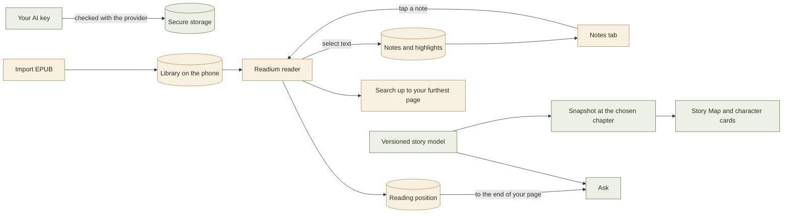
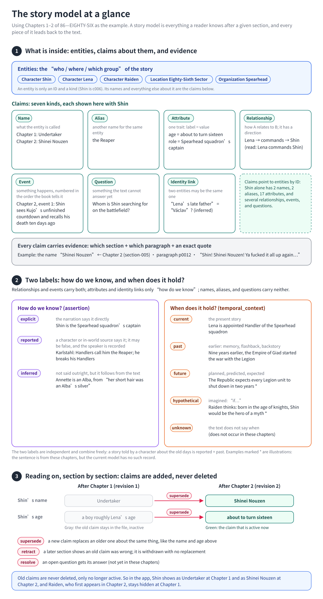

<p align="center">
  
</p>

<h1 align="center">Loremark</h1>

<p align="center">
  <strong>A reading companion that meets you where you are in the story.</strong><br>
  Remember the characters. Revisit your notes. Keep the mystery.
</p>

<p align="center">
  <a href="#what-works-in-the-beta"><strong>What works in the beta</strong></a>
  &nbsp; · &nbsp;
  <a href="#getting-started">Getting started</a>
  &nbsp; · &nbsp;
  <a href="#how-it-works">How it works</a>
  &nbsp; · &nbsp;
  <a href="#the-story-model">The story model</a>
  &nbsp; · &nbsp;
  <a href="#the-team">Team</a>
</p>

<p align="center"><sub>CSE 403 · Flutter app for Android and iOS · Beta release</sub></p>

---

## Pick up the story, wherever you left it

Coming back to a long novel should feel like returning to a familiar world. But names fade, relationships get tangled, and a quick search can reveal the very twist you were hoping to discover yourself.

**Loremark is a reading companion for long, complex books.** It is one Flutter app for Android and iOS that brings EPUB reading, personal notes and highlights, and a spoiler-safe map of the story together around one principle: everything it shows should respect how far you have read.

Its central idea is a **versioned story model**: a record of what was known at each point in the book. Later chapters add to it without rewriting earlier snapshots, so you can look back at the story as you understood it then.

> **Your bookmark is a knowledge boundary.** A question at chapter 7 should be answered with information available through chapter 7.

## What works in the beta

These are our six use cases and where each one stands in this beta.

| Use case | Status | What you can do today |
| :--- | :--- | :--- |
| **3 · Take notes and highlights** | **Operational** | Select text in the reader and choose **Highlight**, **Add note** or **Copy**. Highlights are drawn on the page and stay there as you turn pages. Tap a highlight to edit or remove it. The Notes tab lists every note, with search, a color filter and an **All / Notes / Highlights** toggle. Tap a note to jump back to its passage. |
| **5 · Explore the Story Map** | **Operational** | A relationship graph of the characters, with a chapter slider. Move the slider back and facts from later chapters disappear. The **Chapter** page lists what the reader learned in that chapter. |
| **4 · Look up a character** | **Operational** | A searchable character list, and a card for each character showing what is known as of the chosen chapter. Opening a card by tapping a name in the reader isn't in yet. |
| **1 · Get a recap when you come back** | In progress | |
| **2 · Track a theory** | In progress | |
| **6 · Ask about the story** | **Operational** | Ask a question in the Ask tab. The AI sees the page you are on and looks the rest up in the Story Map, up to the end of that page and no further. Answers stream in and cite their paragraphs: tap a number to read it, then **Open in book** to go there. Pick Ask's model and effort in Settings, apart from Story Map updates. See [docs/ask.md](docs/ask.md). |

These features support the use cases above, and all of them work in the beta:

- **Library and reader.** Import DRM-free EPUBs, read them with [Readium](https://readium.org/), jump to a chapter from the contents, and reopen each book on the page where you left off.
- **Spoiler-safe search.** Search a book, limited to the part you have already read, and jump to a match with the passage highlighted.
- **Your own AI key.** On first launch, connect an OpenAI or DeepSeek API key. Loremark checks the key with the provider and keeps it in the phone's secure storage. You can skip this step and still read, take notes, and look at a Story Map loaded from a file.
- **Offline mode.** Reading, notes and search work without a connection. An offline banner appears, and features that need the network stay locked until you are back online.

### Walkthrough: one use case through every part of Loremark

Use case 3, with the setup it needs, runs through every major part of the app: the AI provider connection, the library, the Readium reader, on-device storage and the Notes tab. Follow these steps on a fresh install:

1. **Connect an AI provider.** Enter an OpenAI or DeepSeek API key. Loremark calls the provider to check it, rejects a key that doesn't work, and saves one that does.
2. **Import a book.** In the library, tap **Import EPUB** and pick a DRM-free EPUB. Loremark copies it into the app's storage and adds it to your library.
3. **Read.** Open the book. Turn pages by swiping or with the arrows, and use the contents button to jump to a chapter.
4. **Highlight and add a note.** Long-press to select a sentence and tap **Highlight**. Select another passage, tap **Add note**, type a thought and save it.
5. **Check that it stays.** Turn the page and come back, then close and reopen the app. The book opens on the same page with your highlight still drawn.
6. **Find it again.** Open the **Notes** tab. Switch between **All**, **Notes** and **Highlights**, then tap your note to jump back to the passage in the Read tab.
7. **Explore the story.** Open the **Story Map** tab, look at the graph and a character card, and drag the chapter slider back to see an earlier point in the story.

## How it works



| Part | What we use |
| :--- | :--- |
| **App** | Flutter 3.47.7 and Dart: one codebase for Android and iOS. |
| **Book rendering** | Readium, through the [`flutter_readium`](https://pub.dev/packages/flutter_readium) 0.8.0 plugin. |
| **On-device storage** | JSON files in the app's private folder: the library, reading positions, each book's notes, and search indexes. |
| **AI provider** | OpenAI or DeepSeek, called straight from the app with the reader's own key. The key is kept with `flutter_secure_storage`. There is no Loremark server. |
| **[Story model](#the-story-model)** | Versioned JSON of characters, relationships and events, each linked to the chapter it comes from. The app shows the snapshot for the chosen chapter. |
| **Connectivity** | `connectivity_plus` drives the offline banner and locks features that need the network. |

### Spoiler and privacy rules

- **Only what you've read.** Search covers the book only up to your furthest page. The Story Map shows the chapter you choose and hides facts from later ones. Ask can use nothing past the end of the page you are on: the app leaves the rest out of what it sends.
- **Earlier snapshots don't change.** A later reveal adds a new snapshot instead of rewriting an earlier one.
- **Your notes stay yours.** Notes and highlights are stored on the phone and are never used as facts about the story.
- **Reading works offline.** The book, your place in it and your notes are all on the device.
- **Your books stay on the phone.** Requests go only to your AI provider: the API key check, Story Map updates you start, and questions you ask in Ask, which carry the page you are on and the parts of the Story Map the AI looks up. [docs/acceptance.md](docs/acceptance.md) describes the privacy audit.

## What's next

**For the final release:**

- A recap when you come back to a book (use case 1).
- A theory tracker that checks your guesses as the story reveals more (use case 2).
- Character cards opened by tapping a name in the reader.

**Stretch goals:** confusion detection that notices rereading and stalls and offers a nudge (in progress), an AI-generated map of the story's world, and, if time allows, training our own model.

## Testing

- **Unit and widget tests.** About 900 tests cover 94% of the lines in `lib/`. Every pull request runs them with `dart format` and `flutter analyze` on GitHub Actions. See [docs/testing.md](docs/testing.md).
- **Start-to-finish test.** `integration_test/app_test.dart` runs the real app on an Android emulator or iPhone simulator: first launch, API key, import, read, search, notes and offline mode. It follows the walkthrough above, except for creating a highlight, which needs native text selection and is covered by widget tests. It passes on an Android emulator and on an iPhone simulator.
- **Acceptance checks.** 20 force-quit trials for restoring your place, an offline trial and a privacy audit run on an Android emulator. See [docs/acceptance.md](docs/acceptance.md).
- **Spoiler safety.** Tests check that search, the story model and Ask never show or send text or facts from later chapters (`test/search/spoiler_property_test.dart`, `test/acceptance/story_model_spoiler_test.dart`, `test/ask/story_lookup_test.dart`, `test/ask/ask_engine_test.dart`).
- **Scale and real books.** See [docs/benchmarks.md](docs/benchmarks.md) and [docs/corpus-testing.md](docs/corpus-testing.md).
- **Bug tracking.** Bugs are GitHub issues with a P0, P1 or P2 label. There are 48 so far, listed with causes and fixes in [docs/bug-log.md](docs/bug-log.md).

## Getting started

[](https://github.com/bennyxzeng/Loremark/actions/workflows/ci.yml)

To set up the app and run the same checks as CI (requires [Flutter 3.47.7](https://docs.flutter.dev/get-started)):

```bash
git clone https://github.com/bennyxzeng/Loremark.git
cd Loremark
flutter pub get
dart format .
flutter analyze
flutter test --exclude-tags "live || benchmark"
```

The start-to-finish test needs a connected emulator, simulator or phone. List devices with `flutter devices`, then run:

```bash
flutter test integration_test -d <device id>
```

### Run the app

The reader uses Readium, so it needs a real device or emulator. `flutter test` uses a fake reader instead. With an Android phone or emulator connected (Android SDK with platform 37):

```bash
flutter run
```

Then follow the [walkthrough](#walkthrough-one-use-case-through-every-part-of-loremark). Any DRM-free EPUB works for reading and notes, for example one from [Project Gutenberg](https://www.gutenberg.org/). iOS builds from the same code and needs iOS 15 or later; so far we have tested on Android. See [docs/epub-reader.md](docs/epub-reader.md) for how the reader works and for Mac and iOS steps.

Have feedback? [Open an issue](https://github.com/bennyxzeng/Loremark/issues) with the reading scenario, the chapter you were on, and what you expected Loremark to do. Clearly label any spoilers in examples.

## The story model

[](docs/story-model-format.md)

Every field and label is explained in [Story Model: file structure and labels](docs/story-model-format.md), in English and Chinese.

## Meet your reading companion

<p align="center">
  <strong>✦ Loremark ✦</strong><br>
  <em>The bookmark spirit who reads beside you.</em>
</p>

<table>
  <tr>
    <td width="38%" valign="middle" align="center">
      
    </td>
    <td width="62%" valign="middle">
      <h3>Character profile</h3>
      <p><strong>Name</strong> · Loremark<br>
      <strong>Role</strong> · Your spoiler-free reading companion<br>
      <strong>Personality</strong> · Gentle, clever, curious, and attentive</p>
      <p><strong>Loves</strong><br>
      Good stories, the notes in your margins, untangling character relationships, and thinking through a theory together.</p>
      <p><strong>Signature look</strong><br>
      Ash-brown hair, amber eyes, forest-green ribbons, a gold star brooch, and an embroidered cloak.</p>
      <p><strong>Her promise</strong><br>
      <em>“I only see as far as you’ve read.”</em></p>
    </td>
  </tr>
</table>

Think of her as the little spirit tucked between your pages: ready with a reminder when a name slips your mind, curious about the theory you scribbled down, and happy to wait while you discover the next chapter yourself. Her warmth, bookish curiosity, and gentle promise come from the original character design.

<p align="center"><strong>✧ Little moments between chapters ✧</strong></p>

<table width="100%">
  <tr>
    <td colspan="3" align="center">
      
    </td>
  </tr>
  <tr>
    <th align="center" width="33%">One more page</th>
    <th align="center" width="34%">Wait… a theory!</th>
    <th align="center" width="33%">Shh… no spoilers</th>
  </tr>
  <tr>
    <td align="center" valign="top"><sub>A good book. A sleepy cat.<br>No hurry.</sub></td>
    <td align="center" valign="top"><sub>Glasses on.<br>Let’s look at the clues.</sub></td>
    <td align="center" valign="top"><sub>The next discovery<br>belongs to you.</sub></td>
  </tr>
</table>

<p align="center">
  <em>“Let’s pause here, and remember all the good things that have happened.”</em><br>
  <sub>— Loremark · adapted from the original character sheet</sub>
</p>

<details>
<summary><strong>View the original character design sheet</strong></summary>

<br>


</details>

<sub>The character sheet was supplied by the project team. The banner, front-view character illustration, and chibi illustrations are AI-generated from that reference. See the <a href="docs/assets/README.md">asset notes and generation prompts</a>.</sub>

## The team

Built as a **CSE 403** team project.

| Team member | Role |
| :--- | :--- |
| **Boheng (Frank) Hao** | Full-stack development |
| **Vitalii Khlivetskyy** | Product management, system design, backend development |
| **Mark Kolivoshka** | Full-stack development, testing |
| **Khanh (Kevin) Pham** | Full-stack development, infrastructure |
| **Gregory Romashchenko** | Backend development, system design |
| **Benjamin Zeng** | Project management, backend development |

---

<p align="center">
  <strong>Your Story, Your Pace.</strong><br>
  <sub>Same story. Deeper understanding.</sub>
</p>
