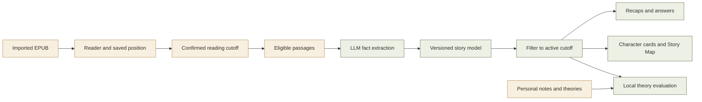
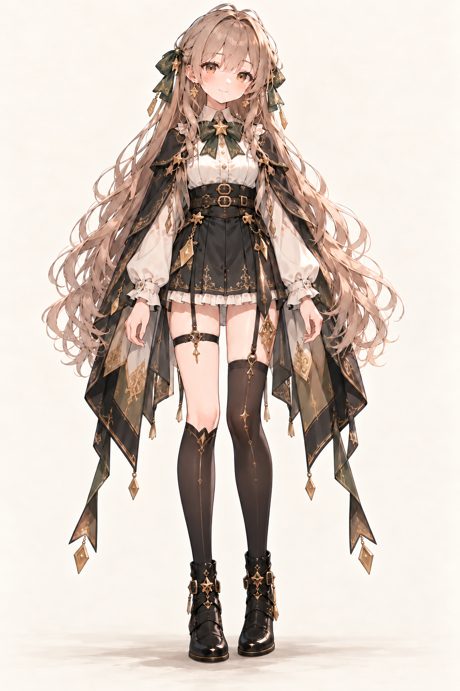
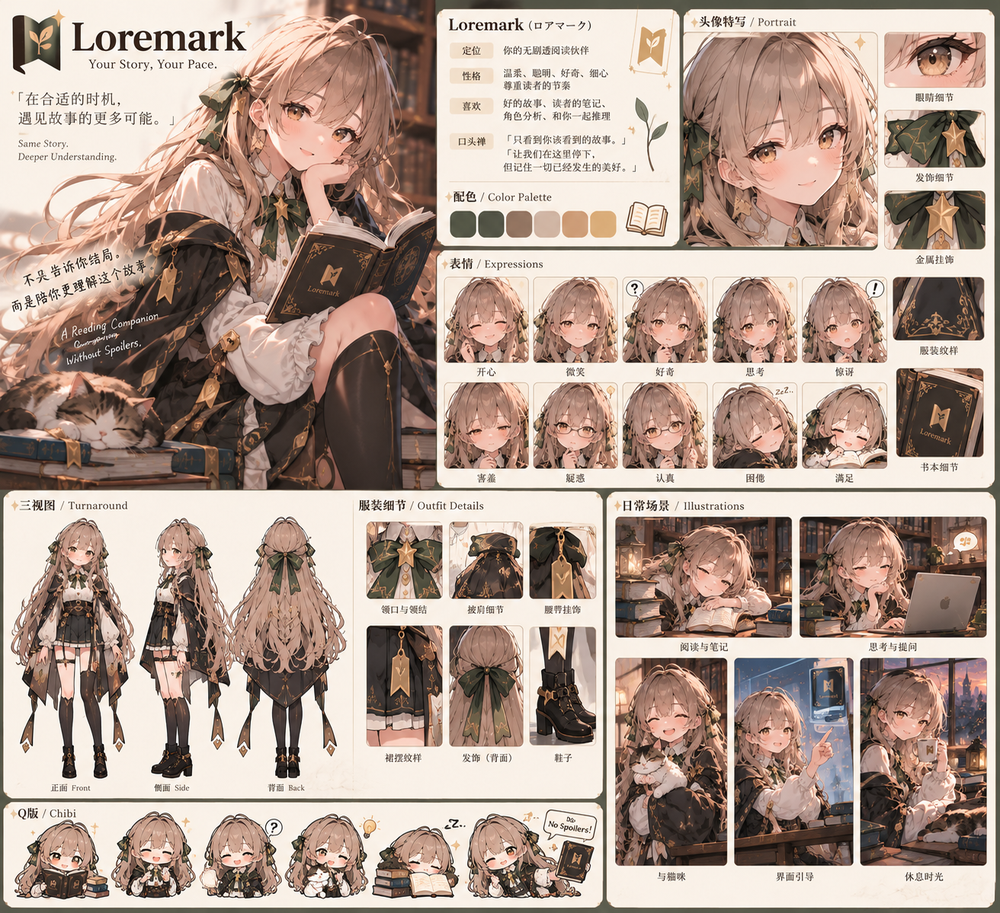

<p align="center">
  
</p>

<h1 align="center">Loremark</h1>

<p align="center">
  <strong>A reading companion that meets you where you are in the story.</strong><br>
  Remember the characters. Revisit your theories. Keep the mystery.
</p>

<p align="center">
  <a href="https://loremark-reading-studio.quietsage16.chatgpt.site/"><strong>Explore the interactive mockup ↗</strong></a>
  &nbsp; · &nbsp;
  <a href="#the-reading-experience">Features</a>
  &nbsp; · &nbsp;
  <a href="#how-it-is-designed-to-work">Architecture</a>
  &nbsp; · &nbsp;
  <a href="#the-team">Team</a>
</p>

<p align="center"><sub>CSE 403 · Planned for iOS · Proposal & design stage</sub></p>

---

## Pick up the story, wherever you left it

Coming back to a long novel should feel like returning to a familiar world. But names fade, relationships get tangled, and a quick search can reveal the very twist you were hoping to discover yourself.

**Loremark is a planned iOS reading companion for long, complex books.** It brings EPUB reading, personal annotations, and AI-assisted recaps together around one principle: every explanation should respect how far you have read.

Its central idea is a **versioned story model**: a record of what was known at each point in the book. Later revelations add new context while preserving earlier snapshots, so you can revisit the story as you understood it then.

> **Your bookmark is a knowledge boundary.** A question at chapter 7 should be answered with information available through chapter 7.

## Take a look

The [interactive reading studio](https://loremark-reading-studio.quietsage16.chatgpt.site/) demonstrates three moments with a fictional book, *The Glass Harbor*:

| Moment | Explore in the mockup |
| :--- | :--- |
| **01 · Find your place** | Return to your saved position and open a “Catch me up” recap. |
| **02 · Follow a theory** | Read, annotate, and follow a hunch as the story unfolds. |
| **03 · Connect the story** | Rewind the character map to an earlier chapter. |

**Current status:** the website is an interaction prototype with simulated theory matching, no live AI, and no EPUB import. This repository currently contains documentation and artwork; the native app and backend are not yet included. The capabilities below describe the proposed product.

## The reading experience

| Planned feature | What it helps you do |
| :--- | :--- |
| **EPUB reader** | Import DRM-free EPUBs, read comfortably, and resume from your saved position. |
| **Welcome-back recaps** | Recover the story’s context with a short summary bounded by a cutoff you confirm. |
| **Ask Loremark** | Ask about characters, events, or relationships and follow source links back to supporting passages. |
| **Story Map** | Explore a character relationship graph with a chapter slider that restores earlier story states. |
| **Character cards** | Recall a character’s first appearance, known relationships, and details revealed so far. |
| **Notes & theories** | Highlight passages, save personal thoughts, and track theories until the text you have reached supports a resolution. |

### A story you can rewind

You are on chapter 25, but your book club is discussing chapter 10. Move the Story Map back to chapter 10 to revisit only the characters and relationships revealed by then. Opening a character card uses that same historical cutoff, while your reading position stays where you left it.

### A place for your hunches

Mark a note as a theory and keep reading. It stays **Unconfirmed** until you reach a passage that settles it. Only then can it become **Confirmed** or **Different outcome**, with the relevant passage available to revisit. Your interpretation stays distinct from facts established by the book.

## How it is designed to work

The proposed architecture combines an iOS reader with a story model that records facts and their source locations, plus requests to an external LLM provider.



| Layer | Proposed approach |
| :--- | :--- |
| **iOS interface** | Swift and SwiftUI, developed with Xcode. |
| **Book rendering** | An existing EPUB toolkit such as Readium, with source-position tracking. |
| **AI integration** | An external LLM provider, called with the reader's own API key, extracts story facts and generates grounded responses. |
| **Story state** | Versioned characters, relationships, locations, and events linked to source passages. |
| **Personal data** | On-device books, reading position, notes, and theories; local theory evaluation is a design target. |

These are proposal choices, not an implemented dependency list. Storage details, API contracts, and the final stack remain to be finalized.

### Boundaries built into the design

- **Filter before answering.** Retrieve only passages and facts available at the active cutoff. The model must also be evaluated for spoilers from its own prior knowledge.
- **Preserve earlier understanding.** A later relationship change or identity reveal must not rewrite an earlier snapshot.
- **Keep notes separate from evidence.** Personal thoughts and theories must not become factual sources for answers, recaps, or graph relationships.
- **Confirm large jumps.** Skipping ahead should not automatically authorize the assistant to summarize unread pages.
- **Keep reading available.** Reading and note-taking should work offline; unavailable AI features should not block them.

The privacy target is to keep complete EPUB files and personal notes/theories on the device, sending only eligible book passages for cloud processing. The exact processing and theory-evaluation design still needs implementation and verification.

## Development roadmap

The CSE 403 proposal targets the following milestones. All remain planned in this repository.

| Phase | Target outcome |
| :--- | :--- |
| **Foundation** | EPUB import, saved reading position, initial story schema, and app–backend connection. |
| **Core experience** | Persistent notes, character cards, source-linked chat, and welcome-back recaps. |
| **Story understanding** | Historical relationship graphs and theory updates tied to eligible evidence. |
| **Beta & verification** | Error handling, offline behavior, reader usability sessions, and spoiler/privacy checks. |
| **Release** | Reproducible setup instructions, installation package, demonstration, and acceptance results. |

**Stretch goals:** optional help when a reader appears confused, and text-to-speech.

<details>
<summary><strong>Planned acceptance checks</strong></summary>

- Restore the reading position within one page in **20 of 20** force-quit trials.
- Observe **zero spoiler leaks across 300 test questions**, including requests at earlier cutoffs.
- Verify **10 theory cases** covering confirmed, different-outcome, and unresolved states.
- Test a **500,000-word EPUB**, with each of 20 chapter-processing trials under 60 seconds and at least 28 of 30 character-card openings under one second.
- Run usability sessions with **five external readers**.
- Verify offline reading and note-taking, and inspect network traffic to check that personal notes/theories and complete EPUB files remain on the device.

These are evaluation targets, not reported test results or a guarantee of spoiler prevention.

</details>

## Getting started

For now, [open the mockup](https://loremark-reading-studio.quietsage16.chatgpt.site/) to explore the intended experience. The Flutter app is in early development.

[](https://github.com/bennyxzeng/Loremark/actions/workflows/ci.yml)

To set up the app and run the same checks as CI (requires [Flutter 3.47.7](https://docs.flutter.dev/get-started)):

```bash
git clone https://github.com/bennyxzeng/Loremark.git
cd Loremark
flutter pub get
dart format .
flutter analyze
flutter test --exclude-tags live
```

See [docs/testing.md](docs/testing.md) for how to add a test and how CI works.

Have feedback? [Open an issue](https://github.com/bennyxzeng/Loremark/issues) with the reading scenario, the chapter boundary, and what you expected Loremark to do. Clearly label any spoilers in examples.

## Meet your reading companion

<p align="center">
  <strong>✦ Loremark ✦</strong><br>
  <em>The bookmark spirit who reads beside you.</em>
</p>

<table>
  <tr>
    <td width="38%" valign="middle" align="center">
      
    </td>
    <td width="62%" valign="middle">
      <h3>Character profile</h3>
      <p><strong>Name</strong> · Loremark<br>
      <strong>Role</strong> · Your spoiler-free reading companion<br>
      <strong>Personality</strong> · Gentle, clever, curious, and attentive</p>
      <p><strong>Loves</strong><br>
      Good stories, the notes in your margins, untangling character relationships, and thinking through a theory together.</p>
      <p><strong>Signature look</strong><br>
      Ash-brown hair, amber eyes, forest-green ribbons, a gold star brooch, and an embroidered cloak.</p>
      <p><strong>Her promise</strong><br>
      <em>“I only see as far as you’ve read.”</em></p>
    </td>
  </tr>
</table>

Think of her as the little spirit tucked between your pages: ready with a reminder when a name slips your mind, curious about the theory you scribbled down, and happy to wait while you discover the next chapter yourself. Her warmth, bookish curiosity, and gentle promise come from the original character design.

<p align="center"><strong>✧ Little moments between chapters ✧</strong></p>

<table width="100%">
  <tr>
    <td colspan="3" align="center">
      
    </td>
  </tr>
  <tr>
    <th align="center" width="33%">One more page</th>
    <th align="center" width="34%">Wait… a theory!</th>
    <th align="center" width="33%">Shh… no spoilers</th>
  </tr>
  <tr>
    <td align="center" valign="top"><sub>A good book. A sleepy cat.<br>No hurry.</sub></td>
    <td align="center" valign="top"><sub>Glasses on.<br>Let’s look at the clues.</sub></td>
    <td align="center" valign="top"><sub>The next discovery<br>belongs to you.</sub></td>
  </tr>
</table>

<p align="center">
  <em>“Let’s pause here, and remember all the good things that have happened.”</em><br>
  <sub>— Loremark · adapted from the original character sheet</sub>
</p>

<details>
<summary><strong>View the original character design sheet</strong></summary>

<br>



</details>

<sub>The character sheet was supplied by the project team. The banner, front-view character illustration, and chibi illustrations are AI-generated from that reference. See the <a href="docs/assets/README.md">asset notes and generation prompts</a>.</sub>

## The team

Built as a **CSE 403** team project.

| Team member | Role |
| :--- | :--- |
| **Boheng (Frank) Hao** | Full-stack development |
| **Vitalii Khlivetskyy** | Product management, system design, backend development |
| **Mark Kolivoshka** | Full-stack development, testing |
| **Khanh (Kevin) Pham** | Full-stack development, infrastructure |
| **Gregory Romashchenko** | Backend development, system design |
| **Benjamin Zeng** | Project management, backend development |

---

<p align="center">
  <strong>Your Story, Your Pace.</strong><br>
  <sub>Same story. Deeper understanding.</sub>
</p>
