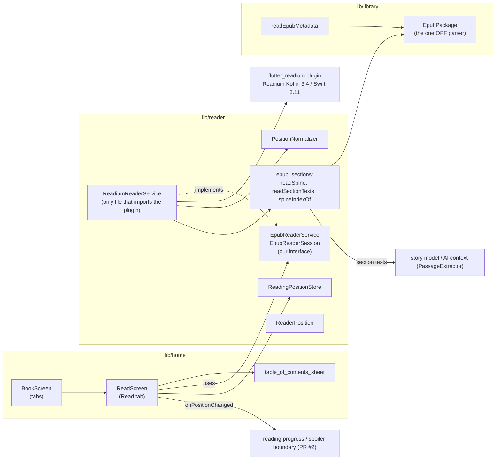

# EPUB reader (Read tab)

How the reading view works, why it's built this way, how other features plug into it, and what to watch out for. Owner: Kevin. Code: [`lib/reader/`](../lib/reader/), [`lib/home/read_screen.dart`](../lib/home/read_screen.dart). Issue #5, PR #6.

**Contents:** [What it does](#what-it-does) · [Try it](#try-it) · [Architecture](#architecture) · [How it works](#how-it-works) · [Why it's built this way](#why-its-built-this-way) · [How other features plug in](#how-other-features-plug-in) · [Storage and privacy](#storage-and-privacy) · [Testing](#testing) · [Platforms and installing](#platforms-and-installing) · [Known problems and fixes](#known-problems-and-fixes) · [Scaling](#scaling) · [Questions we might get](#questions-we-might-get)

## What it does

Living-doc major feature #1 (EPUB reader), milestone #3 and task T2 ("Integrate Readium").

| Requirement | Status |
| :--- | :--- |
| Import a DRM-free EPUB | Already there (Vitalii's library) |
| Read it: text, images, styling, page turns | Done, rendered by Readium |
| Jump to a chapter from the table of contents | Done |
| Save the position and reopen there after a restart or force-quit | Done, saved on every page turn |
| Report the reader's position for the spoiler boundary (T3/T4, PR #2) | Done: spine index + progression, chapter end exactly 1.0 |
| Give the AI pipeline the book's text per section | Done: `readSectionTexts` |
| Friendly error for a missing or broken book; works offline | Done |
| Notes, highlights, Ask, Story Map, spoiler boundary logic | Other features; hooks described [below](#how-other-features-plug-in) |

## Try it

### Getting books

Nothing is bundled. Readers bring their own DRM-free EPUBs, which is the whole product idea, and the app copies each one into its own storage on import. Good free sources: [Project Gutenberg](https://www.gutenberg.org/) (pick "EPUB3 (E-readers incl. Send-to-Kindle)") and [Standard Ebooks](https://standardebooks.org/). Books bought from Kindle/Apple/Google are DRM-protected and won't open.

How to get a file onto the device:

- **Android emulator:** drag the `.epub` from your computer onto the emulator window. It lands in **Downloads**.
- **Android phone / iPhone / iOS Simulator:** open gutenberg.org in the browser on the device and download the EPUB. It goes to Downloads (Android) or Files → Downloads (iOS).
- **Command line (Android):** `adb push book.epub /sdcard/Download/`

Then in the app: **Import EPUB** → in the picker, ☰ → **Downloads** → pick the file. The "Recent" view is often empty for files that were just copied over.

### Using it

1. Tap a book in the library. It opens in the **Read** tab at your saved place, or at the cover the first time.
2. **Turn pages:** swipe, or the **‹ ›** arrows at the bottom. The percentage is how far you are through the whole book.
3. **Chapters:** the bar above the page shows the current chapter. The **≡** button opens the table of contents; tap a chapter to jump there.
4. **Leave and come back:** close or kill the app any time. Reopening it resumes the last book on the same page.
5. **‹** in the header goes back to the library.

### Running it

The reader uses native Readium code, so it runs on a **device or emulator**, not in `flutter test`, Chrome, or as a Windows/macOS desktop app (see [Platforms](#platforms-and-installing)).

All platforms need [Flutter 3.47.7](https://docs.flutter.dev/install/archive) (the version CI uses), then:

```bash
git clone https://github.com/bennyxzeng/Loremark.git
cd Loremark
flutter pub get
flutter run          # pick the emulator / simulator / phone when asked
```

**Windows or Mac, Android emulator**
1. Install [Android Studio](https://developer.android.com/studio).
2. In **SDK Manager**, install **Android SDK Platform 37**. The plugin needs compileSdk 37; Gradle can also download it on the first build.
3. In **Device Manager**, create a device (e.g. Pixel 7, API 36). On Apple Silicon Macs pick an arm64 image.
4. Start the device, then `flutter run`.
5. If `flutter doctor` says no JDK was found: `flutter config --jdk-dir "<Android Studio>/jbr"` (on a Mac: `/Applications/Android Studio.app/Contents/jbr/Contents/Home`).

**Mac, iOS Simulator** (not yet tried by anyone on the team, so report what happens)
1. Install **Xcode** from the App Store and open it once to install the iOS platform. Or run `sudo xcode-select -s /Applications/Xcode.app/Contents/Developer && sudo xcodebuild -runFirstLaunch && xcodebuild -downloadPlatform iOS`.
2. Install Flutter 3.47.7 for macOS and run `flutter doctor`. The Xcode line should be green. CocoaPods isn't needed: every iOS plugin we use, Readium included, comes in through Swift Package Manager, which is on by default in Flutter 3.47.
3. `open -a Simulator`, then `flutter run`. The first build downloads Readium's Swift toolkit, which takes a few minutes.
4. Get a book: in the simulator, open Safari → gutenberg.org → download an EPUB. In the app, Import EPUB → Browse → Downloads.

**Mac, as a Mac app (Apple Silicon only, untested):** Readium has no macOS desktop version, but Apple Silicon Macs can run the iOS build directly. `flutter devices` lists it as "Mac Designed for iPad", and `flutter run -d mac-designed-for-ipad` runs it. Xcode may ask you to pick a signing team (your free Apple ID works).

**A real phone:**
- **Android:** turn on Developer options → USB debugging, plug it in, `flutter run`.
- **iPhone:** needs a Mac with Xcode. Open `ios/Runner.xcworkspace`, set Signing → Team to your Apple ID, then `flutter run`. Free accounts get 7-day signatures.

## Architecture



| File | Role | Living-doc name |
| :--- | :--- | :--- |
| `lib/reader/epub_reader_service.dart` | Interface the screen talks to: open, TOC, position stream, view, navigation, close. | `EPUBReaderService` |
| `lib/reader/readium_reader_service.dart` | Readium adapter. Maps Readium locators to our positions; serializes open/close of the single native reader. | `EPUBReaderService` (implementation) |
| `lib/reader/reader_position.dart` | `(sectionIndex, progression, totalProgression)`. Temporary until PR #2's `TextPosition` lands; same JSON keys. | `TextPosition` |
| `lib/reader/position_normalizer.dart` | Turns Readium's raw numbers into what we report (clamping, chapter-end 1.0). | (part of `ReadingProgressTracker`'s input) |
| `lib/reader/reading_position_store.dart` | Saves/loads each book's position on the device. | reading state file |
| `lib/reader/epub_sections.dart` | Spine list, plain text per section, href → section index. | input for `PassageExtractor` / `SectionBuilder` |
| `lib/library/epub_package.dart` | Container → OPF → manifest + spine. Shared by the library and the reader. | (part of `BookLibrary`) |
| `lib/home/read_screen.dart` | The Read tab: loading, error, chapter bar, page controls, saving. | `ReaderView` |

## How it works

### Words we use

- **Spine:** the EPUB's reading order, the `<itemref>` list in the package file. Each item is one XHTML file, usually one chapter.
- **Section index:** an item's position in the spine, counting **every** itemref, including `linear="no"` ones (footnotes, answer keys). This is the number all of our code agrees on.
- **Progression:** how far into a section, 0.0 to 1.0. **Total progression:** how far into the whole book.
- **Locator:** Readium's position object: href, progression, totalProgression, plus extras such as `currentPage`/`totalPages`.

### Opening a book

1. `ReadScreen` calls `readerService.open(book.epubPath)` and, in parallel, loads the saved position. A broken position file just means starting at the beginning; a broken store never blocks reading.
2. The adapter checks that the file exists (→ "file is missing" message), parses the spine with our own parser in an isolate (→ "not a readable EPUB" message), then asks Readium to open the publication.
3. Opens and closes go through a queue. The plugin has one native reader at a time, so a slow close of book A can never close book B that opened after it.
4. `ReadScreen` builds the reader view **once**. Rebuilding a platform view on every page turn would reload the book. The initial position becomes a Readium locator using the section's href plus its progression.

### Position pipeline

```mermaid
sequenceDiagram
  participant R as Readium (native)
  participant A as ReadiumReaderService
  participant N as PositionNormalizer
  participant S as ReadScreen
  participant D as ReadingPositionStore
  R->>A: Locator (bare), then the same Locator (full, with currentPage/totalPages)
  A->>A: drop duplicates and hrefs not in the spine
  A->>A: href to section index (spineIndexOf), last page to 1.0
  A->>N: ReaderPosition
  N->>S: positions stream (clamped; chapter end = 1.0)
  S->>D: save(book.id, position), on every page turn
  S-->>S: onPositionChanged(position), for the reading tracker
```

Things we learned on the emulator that shaped this:

- **Readium reports where the page starts.** The last page of a 3-page chapter reports 0.666, never 1.0. PR #2 only counts a chapter as read at exactly 1.0. Fix: the full locator carries a zero-based `currentPage` and `totalPages`, and on the last page we report exactly 1.0. If a platform ever leaves those out, `PositionNormalizer` falls back to reporting `(k, 1.0)` when the reader turns from section k into the next one.
- **A chapter jump must not count as finishing the chapter you left.** When page info is present, the fallback is turned off, so a jump from the middle of chapter 2 to chapter 3 never marks chapter 2 as read.
- **Every page is reported twice** (bare, then full), so duplicates are dropped.
- **flutter_readium 0.8.0 never sends its "end of book" event** for EPUBs. We don't depend on it: the last page of the book reaches 1.0 through the page count.
- **Readium skips non-linear spine items** in its reading order. We never use Readium's index; we match by href against our own spine, so indexes always agree with `readSectionTexts`.

### Save and resume

- File: `<app support>/library/reading_state/<book id>.json` holds `{"version":1,"current":{"sectionIndex":11,"progression":0.77,"totalProgression":0.25}}`. `book id` is the EPUB's SHA-256, the same id the library and story models use.
- Writes go to a temp file, then a rename, the same as `BookRepository`. A crash leaves the old position or the new one, never half a file.
- Saves are queued, and fast page turns coalesce, so only the newest position is written. A save keeps any other keys in the file, so PR #2's tracker can store `furthest` and `boundary` next to `current`.
- On the emulator, 5 force-quit and relaunch cycles each reopened on the same page. (The living doc's check is 20 of 20 within one page.)

**The first position after opening must not overwrite the saved one (issue #59, BUG-19).** The screen saved every position the reader reported, including the first. Readium can report a first position that is not the saved one: it opens at the start of the book or chapter and only then jumps, or it never applies the position it was given. On a device, a saved position the reader did not land on was overwritten by `{sectionIndex: 0, progression: 1.0}` within a second of opening, so the next open started at the start. The rule now, in `read_screen.dart`:

- When a book opens with a saved position, saving is held until the reader shows that position. Positions are still passed on and still move the chapter bar and the search cutoff; they are only not written to disk.
- If the first position is somewhere else, the screen asks the reader to jump back to the saved position, once.
- Once the reader shows the saved position, it is saved (this also records the exact progression the reader landed on) and saving is normal from then on.
- "Shows the saved position" means the same section and a progression within 0.02 of the saved one. 0.02 is about one page in a long chapter; a reopened page can land a fraction of a page off (seen on a device: 0.5298 saved, 0.5238 shown).
- After the jump back, positions in the section the reader opened in, or in the saved section, are still held. They are the opening, or Readium honouring the jump only partly. A position in any other section means the reader really moved on: the wait ends and that position is saved, so saving is never blocked for good.
- Why section and not time: Readium sends a bare locator first, and the full locator for the same page can come seconds later. On the emulator a one-page section came out as (0, 0.0) and then (0, 1.0), more than 2 seconds apart on a big book. A time limit (we tried 2 seconds) gave up on the second one and overwrote the saved position. Both arrive in the same section, so the section tells "same page, more detail" from "the reader moved on".
- Known limit: if the jump back fails and the reader swipes on inside the opened or saved section without using the page buttons, those pages are not saved until they reach another section or use the controls. That is the price of never overwriting a good position with an opening one.
- Anything the reader does from the Read tab to move (a Contents jump, a search result, the previous or next page buttons) ends the wait before it moves, so their next position is saved as usual.
- A book with no saved position has nothing to protect, so its first position is saved at once, as before.

### Table of contents

The book's own TOC, flattened with nesting depth. Each entry knows its section index, and entries pointing outside the spine are hidden.

**Which chapter is the reader in?** Several chapters can share one spine file (our Gatsby copy has chapters I to V in one), so the section index alone can't tell. Readium works out the chapter of each page from where it starts and puts it on the page's locator (`tocHref`); the reader passes that on as `chapterChanges`, and the chapter bar shows it. Only when the plugin gives none does the bar fall back to "the last TOC entry in or before the current file".

**Jumping to a chapter.** Readium opens a file you jump into from another file at its *last page* and ignores the chapter you asked for, as if you had turned back into it. Asking again once the file is showing scrolls to the right place. So `_go` in `readium_reader_service.dart` jumps, waits for the file to show (up to 2 seconds), and jumps again; a jump inside the file you are already in needs only one. Search result jumps use the same path. (Measured on the emulator with Gatsby: from chapter IX, every jump to chapter I or III landed at the end of the first file before this, and at the chapter after.)

**A book with no usable TOC.** "Usable" means at least two entries that point into the spine. A missing contents list, an empty one, one with a single entry, or one whose links all point nowhere gets the living doc's plan instead (Risk 3, `SectionBuilder`): the book is cut into sections of about 5,000 words, `Section 1`, `Section 2`, and so on, listed in Contents with a short note saying why.

- The number of sections is `round(words / 5000)`, cut into equal parts. A cut that falls near the start of a spine file moves to that start; the others fall inside a file at the share of its words they are at. Chinese, Japanese and Korean text counts each character as 0.6 of a word.
- A book under about 7,500 words is not cut (nothing to navigate), so its Contents button stays off.
- Jumping to a section goes to that share of the file's *pages*, which is close to, not exactly, the cut, since pages and words differ. Sections are for finding your way, not for the spoiler line, which never depends on them.
- Code: [`lib/reader/toc_builder.dart`](../lib/reader/toc_builder.dart) (`sectionsWithoutToc`); the reader decides when to use it (`_tableOfContents`). Footnote-style files the reader never pages through are left out.

### Section texts for the AI side

`readSectionTexts(epubPath)` returns one plain-text string per spine item, in spine order, parsed in an isolate:

- paragraphs are separated by blank lines;
- scripts, styles and ruby readings are skipped;
- HTML entities are decoded;
- a malformed chapter falls back to tag stripping;
- a missing chapter gives an empty string, so the indexes still line up.

Checked on Frankenstein: section 11 is "Chapter 5" both in the reader and in `readSectionTexts`.

## Why it's built this way

- **Readium**, because the living doc commits to it (Technical Approach, Risk 3). It handles reading order, table of contents and position tracking for messy real-world EPUBs, which is exactly Risk 3 ("EPUB formatting inconsistencies").
- **flutter_readium (Nota)** over the alternatives:
  - **flureadium:** older Readium (Kotlin 3.1, Swift 3.5) and an LGPL license.
  - **Our own platform-channel bridge:** about 1–2 weeks per platform, and flutter_readium already is that bridge.
  - **Rendering XHTML as Flutter widgets:** no CSS, images or fonts for real books, and it isn't Readium.

  flutter_readium wraps the official toolkits, is BSD-3, and was updated weekly in Oct 2026. It is **pinned to exactly 0.8.0** because 0.x releases break the API almost every minor version.
- **Behind our own interface:** the screen and its 24 widget tests run with a fake reader and no native code. If the plugin dies, only one file changes.
- **Spine index + in-section progression** (not just a book percentage): it matches PR #2's `TextPosition`, chapter boundaries are exact, and the number doesn't shift when the font or screen size changes. Total progression is passed along too, since the living doc's `TextPosition` describes it.
- **Paginated** rather than scrolling: page turns are the unit the living doc's tracker and large-jump check think in, and they give clean "on the last page" detection.
- **One parser:** the living doc's Risk 3 and PR #2 both worried about two EPUB parsers disagreeing. The library, the reader and the AI text extraction all go through `EpubPackage`.

## How other features plug in

**Reading progress and spoiler boundary (Grisha, PR #2).** `ReadScreen.onPositionChanged` is the hook, and `BookScreen` is the place to wire it:

```dart
ReadScreen(
  book: widget.book,
  readerService: const ReadiumReaderService(),
  onPositionChanged: (position) => tracker.updatePosition(
    TextPosition(position.sectionIndex, position.progression),
  ),
)
```

When #2 merges:
- swap `ReaderPosition` for `TextPosition`. That's the `TODO(kevin)`; the JSON keys already match.
- the tracker can save its `current`/`furthest`/`boundary` in the same `reading_state` file.
- the large-jump confirmation from the living doc (`ReadingProgressTracker` returns `needsConfirmation`) would show a dialog in `ReadScreen`.

**Story model / AI pipeline (Vitalii, Mark, Frank).** `PassageExtractor(await readSectionTexts(book.epubPath))` gives the finished sections up to the boundary. A section counts as finished only once the reader reaches its last page (exactly 1.0), so the AI never gets the chapter the reader is still in. Section index is the key to store per-chapter story data under: `story_model/<section>/…` in the living doc's layout. The living doc's `SectionBuilder` (group spine items into chapters, or ~5,000-word chunks when there's no TOC) can be built on `readSectionTexts` + `tableOfContents`; it isn't built yet.

**Opening recap / Ask (Use cases 1 and 6).** Both stop where Ask's boundary stops: the end of the reader's page, through `AskBackend.askReach`, not the saved position alone. The recap is an Ask question with its own prompt; its pop-up names the Story Map section the reader is in. See [opening-recap.md](opening-recap.md) and [ask.md](ask.md).

**Notes and highlights (Benjamin, use case 3).** The plugin already supports what notes need, and none of it is wired up yet:
- `ReadiumReaderWidget(onTextSelected: …)` gives the selected text plus a Readium locator for exactly where it is;
- `selectionActions` adds "Highlight" / "Add note" to the selection menu;
- `applyDecorations` draws highlights back onto the page;
- "Open the Read tab at that passage" (6a) is `goToLocator` with the saved locator.

Suggested path: add `onSelection` and `showHighlights` to `EpubReaderSession`, store the full locator JSON with each note, and use our `ReaderPosition` for sorting by chapter.

**Character cards and Story Map (Use cases 4 and 5).**
- "Tap a character name" is the same selection hook.
- The chapter slider can use `tableOfContents` titles and section indexes, capped at the reader's position from the store.

**Offline (non-functional requirement 1).** Reading touches nothing online: the book, the parser and the position are all on the device. That was checked in airplane mode.

## Storage and privacy

| Data | Where | Who writes it |
| :--- | :--- | :--- |
| EPUB copy | `<app support>/library/books/<id>.epub` | `BookRepository` (import) |
| Library list, last opened book | `<app support>/library/library.json` | `BookRepository` |
| Reading position | `<app support>/library/reading_state/<id>.json` | `ReadingPositionStore` |

Everything stays on the device. There's no server: LLM calls (other features) go straight from the app with the reader's own key. The reader itself sends nothing anywhere. Section texts are produced locally, and only finished sections are meant to be sent, one chapter per request, matching the living doc's privacy requirement.

## Testing

`flutter test --exclude-tags live` runs 218 tests (all pass, also in CI). The reader's share:

| Test file | What it covers | Tests |
| :--- | :--- | ---: |
| `test/home/read_screen_test.dart` | Loading/error states, resume, saving, chapter title, contents sheet, page buttons, retry, dispose and book switch during open. Uses a fake reader. | 24 |
| `test/reader/readium_session_test.dart` | The adapter against a fake Readium platform: duplicate locators, last page = 1.0, jumps, open/close ordering, a never-listened close not hanging | 16 |
| `test/reader/readium_reader_service_test.dart` | Locator ↔ position mapping, href formats seen on the device, TOC flattening | 19 |
| `test/reader/position_normalizer_test.dart` | Clamping, snapping, chapter end at 1.0, non-linear items, jumps, end of book | 30 |
| `test/reader/reading_position_store_test.dart` | Restart, corrupt/missing files, leftover temp files, rapid saves, failed writes, keeping other keys | 33 |
| `test/reader/epub_sections_test.dart` | Spine order, non-linear items, text extraction, `spineIndexOf`, alignment of reader and text indexes | 26 |
| `test/reader/reader_position_test.dart`, `test/library/epub_package_test.dart` | JSON round trips, the shared parser | 11 |

Test EPUBs are built in memory by `test/library/test_epub.dart` (`buildEpub(chapters: [...])`); there are no binary fixtures.

Manual, Android emulator (Pixel 7, API 36), on Frankenstein from Gutenberg:
- import, render with images, page turns, contents jump;
- 5 force-quits, each resuming on the same page;
- airplane mode;
- book file deleted, showing the friendly error;
- chapter end saved as exactly 1.0;
- section indexes matching `readSectionTexts`.

**Not tested yet:** iOS (needs a Mac), real phones, a 500,000-word book.

## Platforms and installing

| Platform | Works? | Notes |
| :--- | :--- | :--- |
| Android 7+ (phone or emulator) | Yes, tested on an emulator | Easiest for testers |
| iOS 15+ (iPhone or Simulator) | Should work, untested | Needs a Mac with Xcode to build |
| Mac (Apple Silicon) | Likely, untested | Runs the iOS build ("Designed for iPad") |
| Windows / Linux desktop | No | Readium has no desktop toolkits |
| Web | No | Our library uses `dart:io` files; the plugin's web mode would need a storage rewrite |

Options for letting the TA/professor install it easily:
1. **Android APK on a GitHub Release (recommended).** Build with `flutter build apk --release` and attach it to a release; testers install it on an Android phone or drag it onto an emulator. Release builds are currently signed with the debug key, which is fine for class use. Checked on 11/01: the release APK (about 67 MB) installs on the emulator, opens, renders and resumes the book.
2. **Build from source.** README steps, with an Android emulator on any OS or the iOS Simulator on a Mac.
3. **iOS without building.** Only through TestFlight, which needs a paid Apple Developer account ($99/yr). Probably not worth it for the class.

## Known problems and fixes

| Problem | Impact | Fix / plan |
| :--- | :--- | :--- |
| One spine file with many chapters (some EPUBs do this) | The section index is coarse (the chapter bar and Contents jumps are fixed, see Table of contents) | Spoiler-safe search no longer depends on it (page-level cutoff, [search.md](search.md)); the AI side still counts whole files |
| Book with no TOC | Fixed: cut into sections of about 5,000 words | See Table of contents |
| Plugin is 0.x and young (first release June 2026) | API breaks between minor versions; open issues (#229 scroll-mode back links, #254 release AAB crash report) | Pinned to 0.8.0; everything is behind `EpubReaderService`; only one file changes on upgrade |
| Page count differs between the first open and a cold start (seen: 15 vs 13 pages in one chapter) | The restored progression value differs slightly | Still the same page (page index is what's restored); the living doc only needs "within one page" |
| The first position after opening overwrote the saved one (BUG-19, issue #59): the reader reported the start of the book before, or instead of, the saved place | The next open started at the beginning | Fixed: saving is held until the reader shows the saved position (same section, progression within 0.02), the reader is sent back once if it opens elsewhere, positions in the opened or saved section stay held, and a position in any other section ends the wait; see Save and resume |
| Deleting a book leaves its position file | A tiny orphan file; re-importing the same book resumes there | Delete `reading_state/<id>.json` in `BookRepository.remove` |
| Fonts/themes not adjustable | Accessibility | `EPUBPreferences` supports font size, family, line height and night mode; add a settings sheet |
| iOS untested | Could hit a build or runtime difference | Kevin's Mac test (steps above); the plugin's iOS page info could be 1-based (then the 1.0 would come one page early, harmless) |
| Teammates need Android SDK 37 and AGP 9.1.1 | First build downloads more | Noted in README; the plugin needs it |

## Scaling

The living doc's scalability requirement: 500,000-word books, chapter processing under a minute, and nothing interrupting reading.

- **Rendering:** Readium renders one resource at a time in a WebView and preloads neighbors, so book length barely matters. Pride and Prejudice (24 MB EPUB with images) opened fine.
- **Opening:** we parse only the OPF (spine + manifest), in an isolate, so the UI never stalls. That cost grows with chapter count, not words.
- **Section text:** a 500k-word book is about 3 MB of text, and `readSectionTexts` builds it once in an isolate.
  - It should run **once per book, at import or first open**, with the result cached on disk (e.g. `library/sections/<id>/<n>.txt`). Then the story model reads one chapter at a time instead of re-unzipping.
  - Add a `readSectionText(epubPath, index)` for one chapter if memory gets tight on low-end phones.
- **Saving the position:** saves coalesce, so even fast page turning writes at most one file at a time per book. Each write is about 100 bytes.
- **Many books:** each book is independent (its own EPUB, cover and position file), and `library.json` is small. Thousands of books would mean a lazy library list, not reader changes.
- **The AI side:** because positions are per section and only finished sections count, chapter processing can run in the background, one section at a time, triggered by `onPositionChanged` crossing a section's 1.0, cached per section (living-doc Risk 4: never pay twice).

## Questions we might get

**Why not just show a percentage?** Percentages shift when font size or screen changes, and chapter boundaries matter for spoiler safety. Section index + in-section progression is stable and exact. We still pass the whole-book percentage for display.

**How do you know the reader finished a chapter?** On the last page of a section, Readium's page count says `currentPage == totalPages - 1`, and we report exactly 1.0. If a platform doesn't give page counts, turning into the next section reports the previous one as 1.0, but jumps never do.

**What if the reader skips ahead by accident?** The reader reports every move. Deciding whether a jump counts as "read" is the tracker's job (PR #2, `needsConfirmation` after more than 2 sections). The UI dialog for it goes in `ReadScreen`.

**Can the AI see text past where I am?** Not from the reader. It only gives positions and section texts; `PassageExtractor` (PR #2) returns finished sections up to the boundary, and the section you're in is left out until you finish it.

**What if the EPUB is weird: no TOC, footnotes, odd file names?**
- Non-linear items keep their index, and Readium skips them in page turns.
- Hrefs with spaces, accents, `#fragments` and leading slashes all map correctly; this is tested with real device formats.
- A broken chapter yields empty text, not a crash.
- No TOC (or an unusable one): the book is cut into sections of about 5,000 words, and Contents lists them.

**What if the app crashes mid-save?** The temp file + rename means the old or the new position survives, never a corrupt mix. A corrupt or unknown file is ignored, and the book opens at the start.

**Why is it Android-only right now?** It isn't. iOS uses the same code and config, but none of us can build it without a Mac, so it's untested. Desktop and web aren't supported by Readium.

**What happens if flutter_readium is abandoned?** Only `readium_reader_service.dart` knows about it. A replacement means one new adapter (our own bridge to Readium Kotlin/Swift, or another renderer); the screen, storage and 200+ tests stay.

**How is it tested without a phone?** Everything except the native view runs in `flutter test`. The screen uses a fake reader, and the adapter runs against a fake Readium platform that sends locators shaped like the ones we recorded on the emulator (bare + full, zero-based page counts, percent-encoded hrefs). The native part was checked by hand on an emulator.
