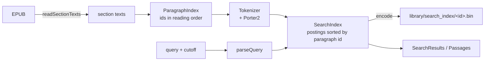

# Passage search

How search over a book works, why a result can never be a spoiler, and how the AI features should call it. Owner: Kevin. Code: [`lib/search/`](../lib/search/). The interface is [`passage_search.dart`](../lib/search/passage_search.dart); the Read tab opens the index lazily and highlights a selected result in Readium.

**Contents:** [What it does](#what-it-does) · [Using it](#using-it) · [How it works](#how-it-works) · [The spoiler guarantees](#the-spoiler-guarantees) · [For the AI features: `retrievePassages`](#for-the-ai-features-retrievepassages) · [Storage](#storage) · [Testing](#testing) · [Limits](#limits)

## What it does

Full-text search over one book that only ever looks at what the reader has already read. A normal e-reader search shows snippets from chapters you haven't reached, which is a spoiler; here the cutoff is part of the engine, not a filter on its output. Every statistic used to rank a result comes from the text before the cutoff, as if the book ended there.

- BM25 ranking over paragraphs, case and accent insensitive, with light English stemming.
- Chinese, Japanese and Korean: overlapping character bigrams, and a plain scan for a single character.
- The word being typed matches longer words (`kle` finds Klein).
- Quoted phrases (`"glass harbor"`) must appear exactly in that order.
- Each result has a snippet with the matched words marked, and a quote the reader can use to jump to the passage and highlight it.
- "3 more matches in chapters you haven't reached": counted, never shown.

## Using it

```dart
final search = await openPassageSearch(bookId: book.id, epubPath: book.epubPath);

final results = search.search('ryn lamp', cutoff: furthestRead, limit: 20);
for (final hit in results.hits) {
  // hit.passage: sectionIndex, paragraphIndex, text, start/endProgression
  // hit.snippet + hit.matches: what to show, and which parts to highlight
  // hit.target: pass to the reader to jump to and highlight the passage
}
print(results.hiddenMatches); // paragraphs past the cutoff with these words
```

- `openPassageSearch` loads the saved index or builds it (a few seconds for a long novel, off the UI isolate) and saves it. Call it when the sheet opens, show "Indexing…" meanwhile, and keep the result for the session.
- `cutoff` is a `ReaderPosition`, the same type the reader reports. Pass the furthest position the reader has reached, captured once per call. A section at exactly `1.0` is finished; one at `0.0` has nothing read.
- `search` is synchronous and takes a few milliseconds (see [Testing](#testing)), so it can run on every keystroke.

## How it works



| File | Role |
| :--- | :--- |
| `tokenizer.dart` | Scans the original text and folds each token, never the text, so offsets stay valid. |
| `stemmer.dart` | Porter2 for English, written from Martin Porter's published algorithm (snowballstem.org, Snowball 3.1.0). |
| `paragraph_index.dart` | Paragraphs, their character offsets, and the cutoff rule. |
| `query.dart` | Quotes, the word being typed, common words, CJK runs. |
| `search_index.dart` | Postings, BM25, prefix, phrases, hidden counts. `SearchIndex implements PassageSearch`. |
| `snippet.dart` | Snippet windows, match spans, and the quote for the reader. |
| `search_index_codec.dart` | The file format. |
| `search_index_store.dart` | Where the file lives, building in an isolate, atomic writes, `openPassageSearch`. |

### Paragraphs

A paragraph is the text between blank lines in a section's plain text. Ids run in reading order (section by section, top to bottom), so what the reader has fully passed is always the **prefix** `[0, k)` of the ids. Each paragraph knows its character offsets, so its start and end as a fraction of the section (`startProgression`) are exact. Non-linear spine items, such as footnotes, have no paragraphs: the reader can't navigate to them, so a hit there couldn't be shown.

### Tokens

- Latin: words, lowercased, accents and `ß æ œ` and full-width letters folded to ASCII. Soft hyphens and zero-width characters inside a word are ignored. `Klein's` is indexed as `klein`; `l'homme` as `homme`.
- Chinese, Japanese, Korean: a run of `n` characters gives `n - 1` overlapping bigrams (`克莱恩` → `克莱`, `莱恩`), as Lucene's `CJKBigramFilter` does. A lone character is a token of its own. The query for a single character scans the text instead, since no bigram holds it alone.
- English stemming is on by default for Latin words. Callers can explicitly disable it with `stem: false` for other Latin languages. The policy is fixed, never inferred from unread text: changing an unread chapter cannot alter visible matches.

### Ranking

BM25 as in Lucene, Tantivy and MiniSearch: `k1 = 1.2`, `b = 0.75`, `idf = ln(1 + (N - n + 0.5) / (n + 0.5))`.

- **Several words** are OR-ed, and the score is scaled by `(matched parts / query parts)²` (Lucene's old coordination factor), so a paragraph with every word beats one with a single rare word. Common words ("where did the") are left out of a question that has other words.
- **Short lines:** a paragraph shorter than half the average is scored as if it were that long, so a three-word line of dialogue doesn't beat a real paragraph for being short. This is our own tweak.
- **Prefix:** the last word, while it is being typed, also matches indexed words that start with it, weighted `0.375 · len / (len + 0.3 · extra letters)` as in MiniSearch, at most 50 words.
- **Phrases:** postings hold no positions. A quoted phrase must have all its words in the paragraph, and the best candidates are then re-tokenized to check the words are next to each other. An unquoted multi-word query gets ×1.5 when its words are adjacent.
- **Snippets** pick the window the way SQLite FTS5's `snippet()` does: the window with the most distinct query parts wins, a window that starts a sentence gets a bonus, and the winner is re-centered on its matches. Windows are measured in characters (180, or 80 for Chinese).

### The quote for the reader

`hit.target` is a `PassageTarget`: the matched stretch of one line of one paragraph, 40 to 120 characters long (the whole line if shorter), cut at word boundaries, plus 32 characters of context on each side, and the progression of its start. Readium finds the quote in the page by its text and falls back to the progression if it can't, so differences between our plain text and the rendered page (hard-wrapped lines, ruby text) cost at most the highlight. The context never reaches past the text the reader has passed.

## The spoiler guarantees

These hold for every call of `search` and `retrievePassages`. Each is enforced in the code named and checked by `test/search/spoiler_property_test.dart` unless noted.

1. **Only fully passed paragraphs.** `k` is the number of paragraphs of earlier sections plus, in the cutoff's section, those that end at or before `floor(progression × section length)`. Whole numbers, so no float comparison can let a paragraph slip across, and a paragraph the cutoff falls inside is excluded (`ParagraphIndex.visibleCount`). The reader reports where the page starts, so the page being read is excluded too, which is the safe side.
2. **No leaking statistics.** `N`, each word's document frequency and the average paragraph length are taken over the first `k` paragraphs only. Postings are sorted by paragraph id, so a word's visible frequency is a binary search for `k`. A word that only appears in the last chapter has, at the cutoff, exactly the weight it would have in a book that ended there. The test builds an index of only the first `k` paragraphs and requires identical hits, scores, snippets and quotes.
3. **Hidden matches are counted from posting tails only.** `hiddenMatches` is the number of paragraphs from `k` on that contain the query's words (every word of a required phrase, at least one word otherwise). It is read from the ends of the postings lists; hidden text is never scored, phrase-checked, or turned into a snippet. The one exception is a single CJK character, which has no postings and is counted by scanning, without producing any text. The test compares it with a brute-force count.
4. **Prefixes only use words already read.** The typed word expands to indexed words with a posting before `k`. Typing `kl` can't reveal a character who first appears later. (Typing a whole word is an exact search, so its hidden count is allowed.)
5. **Snippets, spans and quotes come from visible text.** They are built from the hit's own paragraph, and the quote's context is clamped to the end of the last visible paragraph of the section.
6. **`retrievePassages` returns no counts and no hidden text**, only visible paragraphs, in the order `search` returns them. A count of "3 more" tells a reader that a name appears later; an AI prompt builder should not have even that.
7. **The index API exposes no raw text.** `PassageSearch` has only `search` and `retrievePassages`. (`SearchIndex.toData` exists for the file codec and is not part of the interface.)
8. **The cutoff is read once per call.** The reader's furthest position moves while the sheet is open; the caller captures it and re-runs the query when it changes.
9. **A stale index is never used.** The file carries the book id, the format version and the tokenizer version; any mismatch, truncation or corruption rebuilds it. Paragraph ids can't map to the wrong text. (`search_index_codec_test.dart`, `search_index_store_test.dart`)
10. **Non-linear sections are excluded**, so they can neither leak nor fail to navigate.

Counts are still information: a nonzero `hiddenMatches` for a rare name says it appears later. The UI may round it ("3+"); the AI-facing API doesn't give it at all.

## For the AI features: `retrievePassages`

`ContextManager` and `PassageExtractor` need "relevant passages strictly before the reader's position". Call this instead of sending whole sections:

```dart
final passages = search.retrievePassages(
  'who is Ryn',            // the user's question, or keywords from it
  cutoff: furthestRead,    // the spoiler boundary, from the reading tracker
  limit: 8,
);
// Each Passage: sectionIndex, paragraphIndex, text, startProgression,
// endProgression. Best first. Empty if nothing before the cutoff matches.
final context = passages.map((p) => p.text).join('\n\n');
```

- **`cutoff` must be the spoiler boundary** (the furthest position read, Grisha's tracker once it merges), never the current page. Anything the engine returns is fully before it.
- The query can be a natural question. Common words are dropped, words are stemmed and OR-ed, and paragraphs that match more of them rank higher.
- The result has no scores and no hit counts on purpose. A prompt builder should treat the list as an ordered set of evidence, the first entries being the best.
- A dialogue line or a short paragraph may be a good match but a poor excerpt. Callers that want surrounding context can ask for more passages, or read `startProgression` and join neighbours from the section texts they already have (still clamped to the cutoff).
- Queries are user text. Don't log them with the passages, and don't send passages to a model that the user hasn't consented to.

## Storage

`<app support>/library/search_index/<book id>.bin`, next to `books/` and `reading_state/`. `book id` is validated like in `ReadingPositionStore`: letters, digits, `_` and `-`.

The file is gzip of this, every number a varint: the magic `LMSI`, the format version, a JSON header (book id, tokenizer version, stemmer), the section texts (non-linear ones as a flag only), each paragraph's token count, the sorted terms, and one postings list per term as `(paragraph id delta, frequency)` pairs. The section texts are in it so opening search never unzips and parses the EPUB; paragraphs are found again by splitting them. gzip's CRC-32 detects damage, so the file has no checksum of its own.

- Written to a temp file and renamed, like `BookRepository`, so a crash can't leave half an index.
- A missing, damaged, truncated, other-version or other-book file is built again from the EPUB, in an isolate. If the folder can't be written, search still works for the session.
- Two requests for the same book share one load.
- The root folder can be injected (`openPassageSearch(root: ...)`, `SearchIndexStore(root)`) for tests.

Measured on this Windows host with Flutter 3.47.7 / Dart VM JIT, using the seeded 500,000-word generator: build 566 ms, encode 130 ms, file 1,908 KiB, load 36 ms, query p50 1.880 ms and p95 10.638 ms (100 queries). These are host timings, not phone acceptance results. Run `flutter test --tags benchmark test/search/search_index_perf_test.dart` to regenerate `build/search-benchmark.md`; device performance remains to be measured.

## Testing

`flutter test test/search`. Files mirror `lib/search/`.

- `stemmer_test.dart`: 145 word/stem pairs from the official Snowball English test vocabulary (`voc.txt` and `output.txt` in snowballstem/snowball-data). All 42,649 pairs matched when the stemmer was written.
- `tokenizer_test.dart`, `query_test.dart`, `paragraph_index_test.dart`, `snippet_test.dart`: folding, apostrophes, soft hyphens, CJK bigrams and astral characters, quotes, the cutoff rule at its edges, snippet windows and quote bounds.
- `search_index_test.dart`: ranking, prefix, phrases, Chinese, snippets, hit targets, cutoff behavior, `retrievePassages`.
- `spoiler_property_test.dart`: the guarantees above on seeded random books, queries and cutoffs.
- `search_index_codec_test.dart`, `search_index_store_test.dart`: round trips, corrupt, truncated, wrong-version and wrong-book files, in-memory EPUBs in a temp folder.
- `search_index_perf_test.dart`: 500,000 words, tagged `benchmark`, with a Markdown report and loose time bounds. Normal CI excludes this tag.

## Limits

- No fuzzy matching: a typo finds nothing. A "no results, did you mean" fallback could use edit distance 1 on visible words.
- English stemming only; non-Latin scripts are folded and matched by exact word or CJK bigram. Other Latin languages may overmatch unless callers disable stemming. Thai, Lao and Khmer, which have no spaces, behave as one long word.
- Phrase checks run on the best 60 to 2,000 candidates, so a phrase that is common may rank imperfectly in a very long book.
- Plain text positions are not the page's scroll positions, so a jump relies on the quote; if the page text differs a lot (ruby text), the reader lands near the passage without the highlight.
- The passage is the unit: a hit is a whole paragraph, even a long one.


## Renderer boundary limitation

The production Read tab searches **completed spine sections only**. Readium's page
progression is a layout percentage, not an exact character offset: images and
reflow can otherwise expose text not yet seen in a partially read section.
`completedSectionCutoff` rounds the current/furthest renderer position down to the
last completed section; a reported progression of exactly 1 unlocks that section.
The engine's fractional cutoff remains available for callers with an exact text
boundary. Until that boundary is available, within-current-section search is
intentionally unavailable. A spine section is not necessarily a whole TOC chapter.
