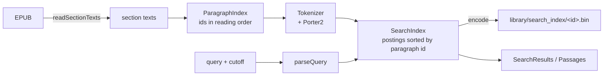

# Passage search

How search over a book works, why a result can never be a spoiler, and how the AI features should call it. Owner: Kevin. Code: [`lib/search/`](../lib/search/). The interface is [`passage_search.dart`](../lib/search/passage_search.dart); the Read tab opens the index lazily and highlights a selected result in Readium.

**Contents:** [What it does](#what-it-does) · [Using it](#using-it) · [How it works](#how-it-works) · [The spoiler guarantees](#the-spoiler-guarantees) · [For the AI features: `retrievePassages`](#for-the-ai-features-retrievepassages) · [Storage](#storage) · [Testing](#testing) · [Limits](#limits)

## What it does

Full-text search over one book that only ever looks at what the reader has already read. A normal e-reader search shows snippets from chapters you haven't reached, which is a spoiler; here the cutoff is part of the engine, not a filter on its output. Every statistic used to rank a result comes from the text before the cutoff, as if the book ended there.

- BM25 ranking over paragraphs, case and accent insensitive, with light English stemming.
- Chinese, Japanese and Korean: overlapping character bigrams, and a plain scan for a single character.
- The word being typed matches longer words (`kle` finds Klein).
- Quoted phrases (`"glass harbor"`) must appear exactly in that order.
- Each result has a snippet with the matched words marked, and a quote the reader can use to jump to the passage and highlight it.
- Matches past the reader's place are never mentioned, not even as "there is more ahead": that would tell a reader a name turns up later. (The engine still counts them, see `hiddenMatches`; the screen doesn't show it.)

## Using it

```dart
final search = await openPassageSearch(bookId: book.id, epubPath: book.epubPath);

final results = search.search('ryn lamp', cutoff: furthestRead, limit: 20);
for (final hit in results.hits) {
  // hit.passage: sectionIndex, paragraphIndex, text, start/endProgression
  // hit.snippet + hit.matches: what to show, and which parts to highlight
  // hit.target: pass to the reader to jump to and highlight the passage
}
print(results.hiddenMatches); // paragraphs past the cutoff with these words
```

- `openPassageSearch` loads the saved index or builds it (a few seconds for a long novel, off the UI isolate) and saves it. Call it when the sheet opens, show "Indexing…" meanwhile, and keep the result for the session.
- `cutoff` is a `ReaderPosition`: a section (spine file) and how far through that file's **text** the reader has seen, counted in characters. Pass the furthest position the reader has reached, captured once per call. A section at exactly `1.0` is finished; one at `0.0` has nothing read. The Read tab builds it with `pageCutoff` ([below](#how-the-read-tab-decides-what-you-have-read)).
- `search` is synchronous and takes a few milliseconds (see [Testing](#testing)), so it can run on every keystroke.

## How it works



| File | Role |
| :--- | :--- |
| `tokenizer.dart` | Scans the original text and folds each token, never the text, so offsets stay valid. |
| `stemmer.dart` | Porter2 for English, written from Martin Porter's published algorithm (snowballstem.org, Snowball 3.1.0). |
| `paragraph_index.dart` | Paragraphs, their character offsets, and the cutoff rule. |
| `query.dart` | Quotes, the word being typed, common words, CJK runs. |
| `search_index.dart` | Postings, BM25, prefix, phrases, hidden counts. `SearchIndex implements PassageSearch`. |
| `snippet.dart` | Snippet windows, match spans, and the quote for the reader. |
| `search_index_codec.dart` | The file format. |
| `search_index_store.dart` | Where the file lives, building in an isolate, atomic writes, `openPassageSearch`. |

### Paragraphs

A paragraph is the text between blank lines in a section's plain text. A paragraph longer than 500 characters is cut into pieces of a few sentences each (about 250 to 400 characters, cut after a full stop, `?`, `!` or a Chinese 。), so "paragraph" below can mean such a piece; see [why](#why-long-paragraphs-are-cut-into-pieces). Ids run in reading order (section by section, top to bottom), so what the reader has fully passed is always the **prefix** `[0, k)` of the ids. Each paragraph knows its character offsets, so its start and end as a fraction of the section (`startProgression`) are exact. Non-linear spine items, such as footnotes, have no paragraphs: the reader can't navigate to them, so a hit there couldn't be shown.

### Tokens

- Latin: words, lowercased, accents and `ß æ œ` and full-width letters folded to ASCII. Soft hyphens and zero-width characters inside a word are ignored. `Klein's` is indexed as `klein`; `l'homme` as `homme`.
- Chinese, Japanese, Korean: a run of `n` characters gives `n - 1` overlapping bigrams (`克莱恩` → `克莱`, `莱恩`), as Lucene's `CJKBigramFilter` does. A lone character is a token of its own. The query for a single character scans the text instead, since no bigram holds it alone.
- English stemming is on by default for Latin words. Callers can explicitly disable it with `stem: false` for other Latin languages. The policy is fixed, never inferred from unread text: changing an unread chapter cannot alter visible matches.

### Ranking

BM25 as in Lucene, Tantivy and MiniSearch: `k1 = 1.2`, `b = 0.75`, `idf = ln(1 + (N - n + 0.5) / (n + 0.5))`.

- **Several words** are OR-ed, and the score is scaled by `(matched parts / query parts)²` (Lucene's old coordination factor), so a paragraph with every word beats one with a single rare word. Common words ("where did the") are left out of a question that has other words.
- **Short lines:** a paragraph shorter than half the average is scored as if it were that long, so a three-word line of dialogue doesn't beat a real paragraph for being short. This is our own tweak.
- **Prefix:** the last word, while it is being typed, also matches indexed words that start with it, weighted `0.375 · len / (len + 0.3 · extra letters)` as in MiniSearch, at most 50 words.
- **Phrases:** postings hold no positions. A quoted phrase must have all its words in the paragraph, and the best candidates are then re-tokenized to check the words are next to each other. An unquoted multi-word query gets ×1.5 when its words are adjacent.
- **Snippets** pick the window the way SQLite FTS5's `snippet()` does: the window with the most distinct query parts wins, a window that starts a sentence gets a bonus, and the winner is re-centered on its matches. Windows are measured in characters (180, or 80 for Chinese).

### The quote for the reader

`hit.target` is a `PassageTarget`: the matched stretch of one line of one paragraph, 40 to 120 characters long (the whole line if shorter), cut at word boundaries, plus 32 characters of context on each side, and the progression of its start. Readium finds the quote in the page by its text and falls back to the progression if it can't, so differences between our plain text and the rendered page (hard-wrapped lines, ruby text) cost at most the highlight. The context never reaches past the text the reader has passed.

## The spoiler guarantees

These hold for every call of `search` and `retrievePassages`. Each is enforced in the code named and checked by `test/search/spoiler_property_test.dart` unless noted.

1. **Only fully passed paragraphs.** `k` is the number of paragraphs of earlier sections plus, in the cutoff's section, those that end at or before `floor(progression × section length)`. Whole numbers, so no float comparison can let a paragraph slip across, and a paragraph the cutoff falls inside is excluded (`ParagraphIndex.visibleCount`). A paragraph that starts on the page but carries on to the next one is not fully read yet, so it is excluded too; that is the safe side.
2. **No leaking statistics.** `N`, each word's document frequency and the average paragraph length are taken over the first `k` paragraphs only. Postings are sorted by paragraph id, so a word's visible frequency is a binary search for `k`. A word that only appears in the last chapter has, at the cutoff, exactly the weight it would have in a book that ended there. The test builds an index of only the first `k` paragraphs and requires identical hits, scores, snippets and quotes.
3. **Hidden matches are counted from posting tails only.** `hiddenMatches` is the number of paragraphs from `k` on that contain the query's words (every word of a required phrase, at least one word otherwise). It is read from the ends of the postings lists; hidden text is never scored, phrase-checked, or turned into a snippet. The one exception is a single CJK character, which has no postings and is counted by scanning, without producing any text. The test compares it with a brute-force count.
4. **Prefixes only use words already read.** The typed word expands to indexed words with a posting before `k`. Typing `kl` can't reveal a character who first appears later. (Typing a whole word is an exact search, so its hidden count is allowed.)
5. **Snippets, spans and quotes come from visible text.** They are built from the hit's own paragraph, and the quote's context is clamped to the end of the last visible paragraph of the section.
6. **`retrievePassages` returns no counts and no hidden text**, only visible paragraphs, in the order `search` returns them. A count of "3 more" tells a reader that a name appears later; an AI prompt builder should not have even that.
7. **The index API exposes no raw text.** `PassageSearch` has only `search` and `retrievePassages`. (`SearchIndex.toData` exists for the file codec and is not part of the interface.)
8. **The cutoff is read once per call.** The reader's furthest position moves while the sheet is open; the caller captures it and re-runs the query when it changes.
9. **A stale index is never used.** The file carries the book id, the format version and the tokenizer version; any mismatch, truncation or corruption rebuilds it. Paragraph ids can't map to the wrong text. (`search_index_codec_test.dart`, `search_index_store_test.dart`)
10. **Non-linear sections are excluded**, so they can neither leak nor fail to navigate.

Counts are still information: a nonzero `hiddenMatches` for a rare name says it appears later. So neither the search screen nor the AI-facing API shows it. It stays in `SearchResults` only because the engine tests check it.

## For the AI features: `retrievePassages`

`ContextManager` and `PassageExtractor` need "relevant passages strictly before the reader's position". Call this instead of sending whole sections:

```dart
final passages = search.retrievePassages(
  'who is Ryn',            // the user's question, or keywords from it
  cutoff: furthestRead,    // the spoiler boundary, from the reading tracker
  limit: 8,
);
// Each Passage: sectionIndex, paragraphIndex, text, startProgression,
// endProgression. Best first. Empty if nothing before the cutoff matches.
final context = passages.map((p) => p.text).join('\n\n');
```

- **`cutoff` must be the spoiler boundary** (the furthest position read, Grisha's tracker once it merges), never the current page. Anything the engine returns is fully before it.
- The query can be a natural question. Common words are dropped, words are stemmed and OR-ed, and paragraphs that match more of them rank higher.
- The result has no scores and no hit counts on purpose. A prompt builder should treat the list as an ordered set of evidence, the first entries being the best.
- A dialogue line or a short paragraph may be a good match but a poor excerpt. Callers that want surrounding context can ask for more passages, or read `startProgression` and join neighbours from the section texts they already have (still clamped to the cutoff).
- Queries are user text. Don't log them with the passages, and don't send passages to a model that the user hasn't consented to.

## Storage

`<app support>/library/search_index/<book id>.bin`, next to `books/` and `reading_state/`. `book id` is validated like in `ReadingPositionStore`: letters, digits, `_` and `-`.

The file is gzip of this, every number a varint: the magic `LMSI`, the format version, a JSON header (book id, tokenizer version, stemmer), the section texts (non-linear ones as a flag only), each paragraph's token count, the sorted terms, and one postings list per term as `(paragraph id delta, frequency)` pairs. The section texts are in it so opening search never unzips and parses the EPUB; paragraphs are found again by splitting them. gzip's CRC-32 detects damage, so the file has no checksum of its own.

- Written to a temp file and renamed, like `BookRepository`, so a crash can't leave half an index.
- A missing, damaged, truncated, other-version or other-book file is built again from the EPUB, in an isolate. If the folder can't be written, search still works for the session.
- Two requests for the same book share one load.
- The root folder can be injected (`openPassageSearch(root: ...)`, `SearchIndexStore(root)`) for tests.

Measured on this Windows host with Flutter 3.47.7 / Dart VM JIT, using the seeded 500,000-word generator: build 566 ms, encode 130 ms, file 1,908 KiB, load 36 ms, query p50 1.880 ms and p95 10.638 ms (100 queries). These are host timings, not phone acceptance results. Run `flutter test --tags benchmark test/search/search_index_perf_test.dart` to regenerate `build/search-benchmark.md`; device performance remains to be measured.

## Testing

`flutter test test/search`. Files mirror `lib/search/`.

- `stemmer_test.dart`: 145 word/stem pairs from the official Snowball English test vocabulary (`voc.txt` and `output.txt` in snowballstem/snowball-data). All 42,649 pairs matched when the stemmer was written.
- `tokenizer_test.dart`, `query_test.dart`, `paragraph_index_test.dart`, `snippet_test.dart`: folding, apostrophes, soft hyphens, CJK bigrams and astral characters, quotes, the cutoff rule at its edges, snippet windows and quote bounds.
- `search_index_test.dart`: ranking, prefix, phrases, Chinese, snippets, hit targets, cutoff behavior, `retrievePassages`.
- `spoiler_property_test.dart`: the guarantees above on seeded random books, queries and cutoffs.
- `search_index_codec_test.dart`, `search_index_store_test.dart`: round trips, corrupt, truncated, wrong-version and wrong-book files, in-memory EPUBs in a temp folder.
- `search_index_perf_test.dart`: 500,000 words, tagged `benchmark`, with a Markdown report and loose time bounds. Normal CI excludes this tag.

## Limits

- No fuzzy matching: a typo finds nothing. A "no results, did you mean" fallback could use edit distance 1 on visible words.
- English stemming only; non-Latin scripts are folded and matched by exact word or CJK bigram. Other Latin languages may overmatch unless callers disable stemming. Thai, Lao and Khmer, which have no spaces, behave as one long word.
- Phrase checks run on the best 60 to 2,000 candidates, so a phrase that is common may rank imperfectly in a very long book.
- Plain text positions are not the page's scroll positions, so a jump relies on the quote; if the page text differs a lot (ruby text), the reader lands near the passage without the highlight.
- The passage is the unit: a hit is a whole paragraph, or a few sentences of a long one. A piece can start mid-paragraph, so a result may begin with a lowercase word.


## How the Read tab decides what you have read

**The goal:** if you are on a page in chapter 9 that says "Gatsby", searching "Gatsby" finds that page and everything before it. If you are on a page in chapter 6 that does not say it, you only see the earlier places it appears, never anything after your page.

### Why this is harder than it sounds

- **A book file is not a chapter.** An EPUB is a zip of web pages ("spine files"). Many have one file per chapter, but others pack a lot into one file. Our Great Gatsby copy has chapters 1 to 5 in one file (about 25,800 words) and chapters 6 to 9 in another. The first version of search only unlocked a file once you had *finished* it, so nothing was searchable until the end of chapter 5.
- **Pages are not a share of the text.** Readium (the reading engine) says "you are 40% through this file" by *pages*. Images, headings and the screen size change how many pages the text takes, so 40% of the pages is not 40% of the words. Using that number to cut off text could show words you have not reached yet.

So the cutoff has to come from the *words*, not from page percentages.

### The idea: find where your page ends

1. Readium lays the chapter out in columns, one per page. A small script we add to every chapter ([`assets/reader/page_end.js`](../assets/reader/page_end.js)) looks at the paragraphs ("text blocks") in order and finds the first one whose last line is not on your page. It reports two numbers: which paragraph ("the 28th of this chapter"), and how many of its characters, not counting spaces, are on your page ("1,076").
2. The app counts paragraphs and characters the same way in its own copy of the chapter's text ([`textProgressionOfBlock`](../lib/reader/epub_sections.dart)) and works out exactly where in the text your page ends, as a share of the chapter: for example `0.0276`.
3. That share becomes the search cutoff. Search only returns passages that *end* before it. Everything on your page up to the last full sentence piece is searchable, and the piece that carries on to the next page waits until you turn the page.

We count *numbered paragraphs and non-space characters*, not "the third `<div>` inside `<body>`" or raw character positions. Readium sometimes adds empty helper elements to a page, and the app's text collapses whitespace, so positions like those would drift; paragraph numbers and non-space character counts do not. The app also refuses an answer that points past the end of its paragraph, so a wrong report can only make search more cautious (it then falls back, see below), never reveal more.

### Why long paragraphs are cut into pieces

Novels often have paragraphs longer than a page. If the paragraph were the unit, a page that sits inside one long paragraph would unlock nothing, and a name you can see on the page would not be searchable. Pieces of a few sentences mean a page break hides at most the piece it falls in, a couple of lines.

Cutting is done when the index is built (`ParagraphIndex`, constant `maxParagraphChars`). Because it changes what a "passage" is, the saved index format version went from 1 to 2, so old index files are rebuilt automatically the first time a book is searched.

### Example: The Great Gatsby

Tested on the Android emulator with the Project Gutenberg copy, whose chapters 1 to 5 are one file of about 25,800 words. On the page that starts "from the East last autumn…":

- The page ends inside paragraph 27 after 1,076 characters. Searching **Gatsby** finds the title lines before it and the sentences of that paragraph that are on the page ("Only Gatsby, the man who gives his name to this book…"), but not the later piece that runs onto the next page.
- Searching **abortive**, a word that is only in the first line of the next page, finds nothing and shows no hint that there is more.
- After turning the page, searching **abortive** finds it.

### When it falls back to the old rule

Anything unexpected leaves the page unmeasured and the app then does what the first version did, unlocking only finished files:

- the book is right-to-left or vertical,
- the script could not be added or did not run,
- the chapter is not well-formed XML,
- the page has no text block past it (the last page of a chapter, which is already counted as finished).

The cutoff only ever moves forward during a reading session (`pageCutoff` takes the later of the finished-file rule and the measured page), so turning back to reread does not hide what you have already seen.

### Where the pieces are

| Piece | File | Role |
| :-- | :-- | :-- |
| Page script | `assets/reader/page_end.js` | Reports the first text block past the page, riding on Readium's own page report. |
| Reader adapter | `lib/reader/readium_reader_service.dart` | Registers the script, reads the report (`pageEndBlock`), looks up the text offset in the background, and emits it on `pageTextEnds`. |
| Text offsets | `lib/reader/epub_sections.dart` | `textProgressionOfBlock`: paragraph number to a share of the chapter text. Uses the same text as the search index. |
| Cutoff | `lib/search/search_cutoff.dart` | `pageCutoff` combines the measured page with the finished-file rule. |
| Screen | `lib/home/read_screen.dart` | Keeps the furthest measured page and updates the cutoff the search sheet watches. |

### Known limits and risks

- **A piece is the unit.** The piece of text that carries over onto the next page (a few lines, never more than about 400 characters unless one sentence is longer) becomes searchable once you turn the page. A single sentence longer than a page is never cut.
- **The script is served through a font declaration.** The plugin's web view only serves its own files and the fonts an app declares. To get `page_end.js` served we declare it as a font file for a family nothing uses (`_servedScript` in `readium_reader_service.dart`). It is a workaround for a plugin limit, and the code says so; without it the page gets an error page instead of the script (seen in the first device test).
- **Right-to-left and vertical books are not measured.** They use the finished-file rule.
- **It depends on a Readium plugin detail.** The script puts its answer in the `physicalPage` field, which the plugin copies through untouched. The plugin is pinned to 0.8.0; after an upgrade, check that `pageTextEnds` still reports (the debug build logs `LOREMARK_PAGE_TEXT` lines). If it stops working, search quietly falls back to finished files, which is safe but coarse.
- **iOS needs a patched plugin.** `flutter_readium`'s iOS side (0.8.0 and 0.9.0) accepts JavaScript injections but never applies them, so the app uses a copy in `third_party/flutter_readium` that does; see its `LOREMARK.md`. Without the patch the page script doesn't run on iOS, search uses the finished-file rule there, and Ask can't see the page.
- **Jumping ahead still counts as reading.** Choosing a late chapter from Contents moves the cutoff there, so everything before it becomes searchable. (Separate from search: on the Gatsby file, choosing chapter I from Contents landed at the end of the chapters 1 to 5 file instead of the start of chapter I, so the Contents jump for several chapters in one file needs its own look.) Gregory's `ReadingProgressTracker` (PR #2) is built to ask "did you read this?" before moving the boundary; once it is wired into the Read tab, search should use `tracker.boundary` instead of the furthest page. His tracker needs the same *kind* of position (characters, not pages) that this change produces.
- **The measured page is not saved.** After closing and reopening the book, search starts from the saved reading position (finished files) until you turn a page. Saving it belongs with the tracker's saved state.
- **The cutoff is a `ReaderPosition`.** Gregory's `TextPosition` (same shape, spine file plus share of its text) is what the reader reports for measured pages (`pageTextEnds`). `PassageSearch` itself still takes a `ReaderPosition`; moving it to `TextPosition` is a rename that was left out to keep this change small.
