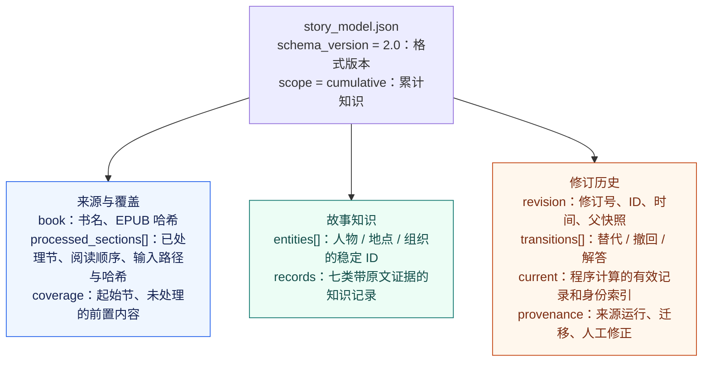
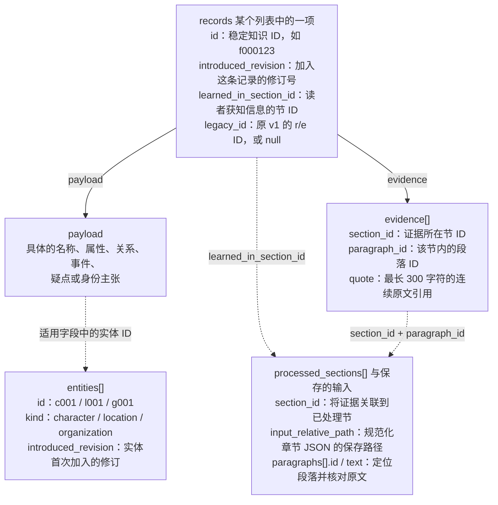
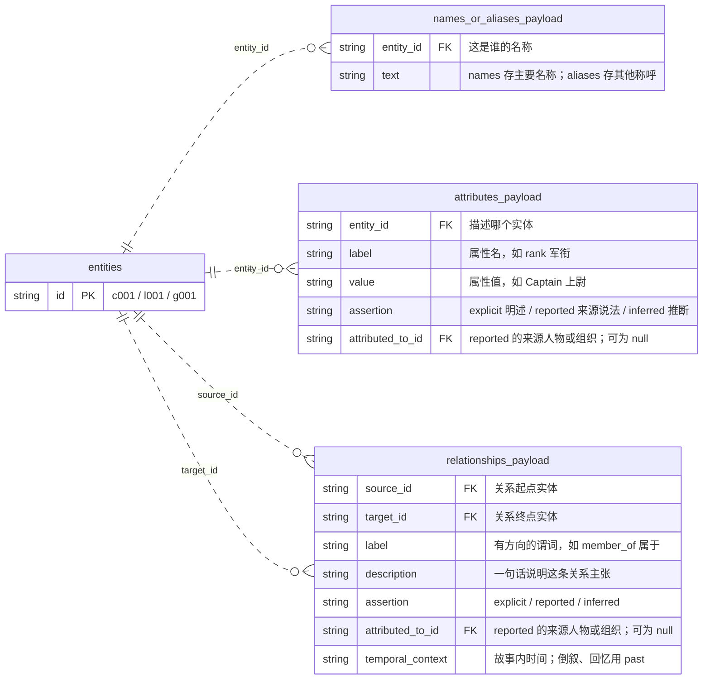
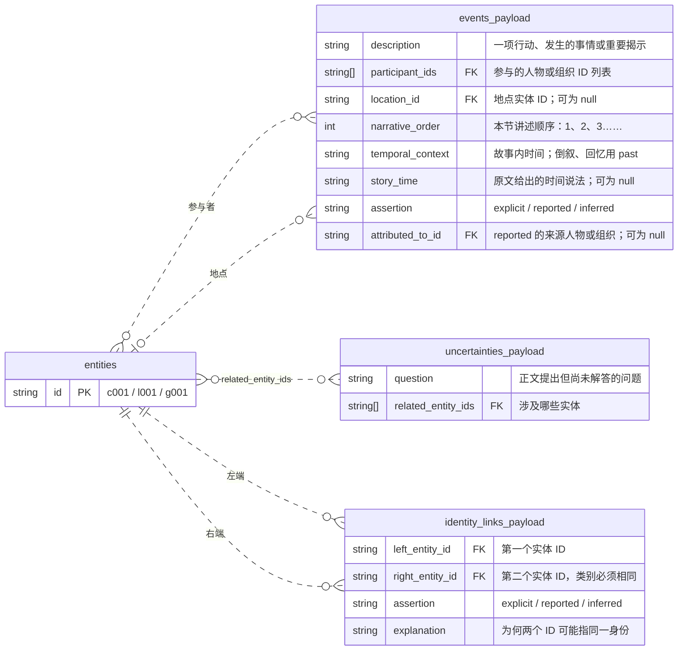
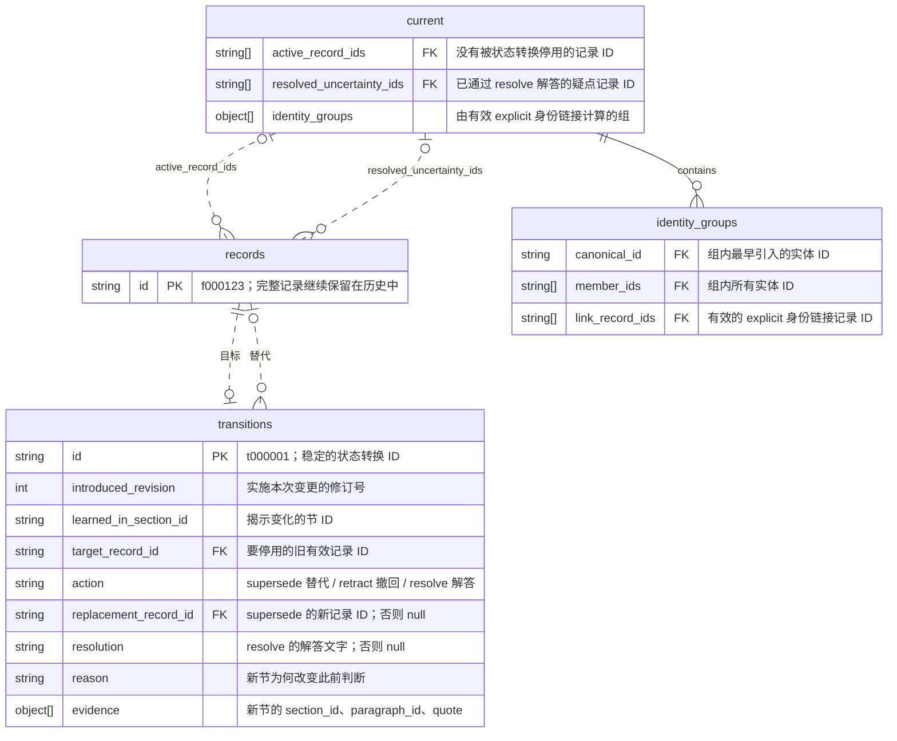

# Story Model：文件结构与标签说明

[](STORY_MODEL_FORMAT.md) [](STORY_MODEL_FORMAT.zh-CN.md)

[返回 README](README.zh-CN.md) · [结构总览图](#visual-overview) · [文件结构](#file-structure) · [人物与知识记录](#characters-and-records) · [事件](#events) · [标签含义](#labels) · [历史修订](#revisions) · [单章格式](#single-chapter-format)

Story Model 记录的是：**正文介绍了哪些人物、地点和组织，发生了什么，它们有什么关系，还有哪些疑点，以及每条主张由哪些原文支持**。它还保留读者何时得知一条信息，以及后续章节如何改变已有认知。

当前累计示例是 [`stores/86v1/story_model.json`](stores/86v1/story_model.json)；[`ch2_story_model.md`](../../ch2_story_model.md) 是便于阅读的静态导出。本页主要介绍累计模型 **v2**，末尾也说明 **v1 单章模型**的区别。

先区分两个标签：`assertion: "inferred"` 表示“根据文本推断”；`temporal_context: "past"` 表示“叙事当前时间之前”，包括 **flashback（倒叙、回忆）**。**文件里没有单独的 `flashback` 枚举值。** 过去的事件同样可以是 `explicit`、`reported` 或 `inferred`。

<a id="visual-overview"></a>

## 结构总览图

下面的图展示累计模型 **v2** 的 JSON 结构。方框保留实际字段名，旁边说明其值存什么。`[]` 表示列表，`null` 表示没有值，ID 字段指向另一个已保存的对象。蓝色是来源信息，绿色是故事知识，橙色是修订历史。



继续看[记录外层与证据](#record-diagram)、[实体属性与关系](#entity-payload-diagram)、[事件与身份链接](#event-payload-diagram)、[历史修订关联](#revision-diagram)的字段图。下方表格补充各项来源元信息的具体字段。

<a id="file-structure"></a>

## 文件结构

### 模型周围有哪些文件

| 路径 | 记录什么 |
| --- | --- |
| `stores/<name>/story_model.json` | 最新已提交的累计模型；查看目前累积的知识，应读这个文件。 |
| `stores/<name>/revisions/<revision>-<id>.json` | 每次已提交修订的完整快照，保留当时已知的信息。 |
| `stores/<name>/inputs/<section>-<hash>.json` | 规范化章节正文与段落 ID，用于核对证据。 |
| `stores/<name>/provenance/` | 初次导入、历次更新的来源文件、ID 映射、manifest 和人工修正记录。 |
| `runs/<run-id>/story_model.json` | `generate` 产生、通过校验的 **v1 单章模型**，尚未经过 `init`。 |
| `runs/<run-id>/story_model.after.json` | 更新运行产生的累计候选模型；仅有这个文件不代表已经提交。 |
| 导出的 `.md` 文件 | 某次修订的阅读版；后续更新后需要重新导出才会刷新。 |

Git 中的示例 JSON 和修订快照可以直接阅读。运行 `show`、`update` 还需要配套的本地 `inputs/`、`provenance/`，详见[与组员共享模型](README.zh-CN.md#与组员共享模型)。

### v2 `story_model.json` 里面有什么

| 顶层字段 | 内容与用途 |
| --- | --- |
| `schema_version` | `"2.0"`，表示文件格式版本。 |
| `scope` | `"cumulative"`，表示按已处理章节累计的知识。 |
| `book` | `title` 和 `epub_sha256`：书名与原始 EPUB 文件的指纹。 |
| `revision` | `number`、`id`、`created_at`、`source_run_id`、`parent_snapshot_path`、`parent_sha256`：当前提交及其上一份快照。首次修订的父快照字段为 `null`。 |
| `processed_sections` | 各节的 `section_id`、阅读顺序 `section_order`、`chapter_number`、`title`、EPUB 位置 `href`/`fragment`、`text_sha256`、`extraction_version`、`paragraph_count`、保存的输入路径与哈希 `input_relative_path`/`input_file_sha256`，以及 `introduced_revision`。间章等非编号章节的 `chapter_number` 可以为 `null`。 |
| `coverage` | `start_section_id` 和 `omitted_prefix_section_ids`：从哪一节开始处理、此前哪些节尚未处理。 |
| `entities` | 人物、地点、组织的稳定 `id`、类别 `kind` 和首次引入的 `introduced_revision`。名称和具体事实另存于 `records`。 |
| `records` | 七类知识记录：`names`、`aliases`、`attributes`、`relationships`、`events`、`uncertainties`、`identity_links`。旧记录保留，不被原地修改。 |
| `transitions` | 有证据支持的历史变更：替代旧记录、撤回主张或解答疑点。 |
| `current` | 程序计算的索引：`active_record_ids`、`resolved_uncertainty_ids`、`identity_groups`。 |
| `provenance` | `initial_run_id`、`migration_version`、`imported_manual_corrections`、`update_manual_corrections`：初始来源、迁移版本与人工修正审计。旧 store 可能没有 `update_manual_corrections`。 |

这里的 **section（节）**可以是正文章节、序章或间章。`section-004`、Chapter 1、revision 1 分别是阅读顺序中的节 ID、小说章节号、成功导入/更新的修订次数，不能混用。判断覆盖范围时，要同时看 `processed_sections` 和 `coverage`。

<a id="characters-and-records"></a>

## 人物与知识记录

### 实体类别与 ID

| `entities[].kind` | ID 示例 | 包含什么 |
| --- | --- | --- |
| `character` | `c001` | 独立人物，或被当作人物对待的个体；也包括仅被提及、没有出场的人。 |
| `location` | `l001` | 国家、城市、建筑、房间、战场等地点。 |
| `organization` | `g001` | 集体行动的组织或群体，如政府、军队、小队、机构、派系。 |

例如“小队”是组织，“小队队长”是人物，“小队基地”是地点。累计更新时实体 ID 保持稳定；后来知道某人的真名，不会因此给这个人更换 ID。

### 每条知识记录共有的外层字段

`records` 下七类列表中的每个元素都具有以下结构：

| 字段 | 含义 |
| --- | --- |
| `id` | 稳定的知识记录 ID，例如 `f000123`。它标识一条主张，不是人物 ID，也不表示事件类别。 |
| `introduced_revision` | 这条记录在哪一次修订中加入。 |
| `learned_in_section_id` | 读者在哪一节得知这条信息；事件本身可能发生在很久以前。 |
| `legacy_id` | 从 v1 导入时保留的原始 ID，例如 `r001`、`e001`；不适用时为 `null`。 |
| `payload` | 具体主张，其字段由记录类别决定。 |
| `evidence` | 支持它的原文：`{section_id, paragraph_id, quote}`。段落 ID 只在一节内有效，定位时必须同时看节 ID。 |

每条记录都必须有证据。`quote` 必须是对应段落中逐字一致的连续片段，最长 300 个字符。累计更新新增的记录和状态转换引用的是**新加入的这一节**。引用匹配只能证明这些文字存在，仍需人工判断它们是否支持该主张。

<a id="record-diagram"></a>

### 一条记录如何连接主张与证据

实线表示内部包含，虚线表示通过 ID 引用。七类记录都使用这层外壳；不同类别的 `payload` 在后面两张图中展开。



### 七类知识分别记录什么

| 集合 | 记录内容 | `payload` 内的字段 |
| --- | --- | --- |
| `names` | 实体的主要名称或称谓；未知道真名时，也可以用头衔、代号。 | `entity_id`、`text` |
| `aliases` | 正文能证明属于同一实体的其他称呼。 | `entity_id`、`text` |
| `attributes` | 实体的单项属性，如年龄、军衔、外貌、职业、隶属、能力。 | `entity_id`、`label`、`value`、`assertion`、`attributed_to_id` |
| `relationships` | 实体之间有方向的关系，并附说明与时间背景。 | `source_id`、`target_id`、`label`、`description`、`assertion`、`attributed_to_id`、`temporal_context` |
| `events` | 具体行动、发生的事情或重要揭示，以及参与者、地点、叙述顺序与时间。 | `description`、`participant_ids`、`location_id`、`narrative_order`、`temporal_context`、`story_time`、`assertion`、`attributed_to_id` |
| `uncertainties` | 尚未解答的身份、指代、原因或矛盾等问题。 | `question`、`related_entity_ids` |
| `identity_links` | 两个原本分别记录的实体其实是同一个人、地点或组织的主张。 | `left_entity_id`、`right_entity_id`、`assertion`、`explanation` |

属性的 `label`（如 `rank`）和关系的 `label`（如 `member_of`）是描述性字符串，**不是固定枚举列表**。关系按“**起点 → 标签 → 终点**”理解：`c001 → member_of → g001` 表示人物属于某个组织，方向颠倒含义就不同。三类实体之间都可以建立关系。

标签并非每类记录都有：`assertion` 用于属性、关系、事件和身份链接；`temporal_context` 仅用于关系和事件。名称、别名、疑点有证据，但没有 `assertion` 字段；此格式中的属性也没有单独的时间背景字段。

别名是为一个已经认定的实体补充称呼；身份链接则连接**两个已有 ID**，且必须是同一实体类别。只有仍有效的 `explicit` 身份链接会产生 `current.identity_groups`，其中包含 `canonical_id`、`member_ids`、`link_record_ids`。最早引入的实体提供 canonical ID，同次引入时按 ID 排序；原实体和记录仍保留。`reported`、`inferred` 身份链接不会合并展示身份。

<a id="entity-payload-diagram"></a>

### 实体属性与关系的字段图

下图展开 `names`/`aliases`、`attributes`、`relationships` 的 `payload`；每一项外面仍有前图中的公共外层和证据，实体的完整字段也见前图。`PK` 表示对象自身的 ID，`FK` 表示指向其他对象的 ID。每条记录通过连线上标明的字段关联实体；关系同时连接起点和终点。



例如 `source_id = c001`、`label = member_of`、`target_id = g001`，就是**人物 → 属于 → 组织**。`attributed_to_id` 也引用 `entities`，但只能指向人物或组织；它说明是谁提出 `reported` 主张，而不是主张描述的是谁。

<a id="events"></a>

## 事件

| 事件 `payload` 字段 | 如何理解 |
| --- | --- |
| `description` | 一项主要行动或发生的事情，而不是整段正文的摘要。 |
| `participant_ids` | 参与的人物或组织 ID。 |
| `location_id` | 地点实体 ID；地点无法确定时为 `null`。 |
| `narrative_order` | 本节讲述事件的顺序：1、2、3……，在同一节内连续且不重复；不是全书的真实时间线。 |
| `temporal_context` | 相对本节叙事当前时间，属于当前、过去、未来、假设还是时间不明。 |
| `story_time` | 原文提供的时间说法，如 `"spring"`、`"nine years ago"`；没有说明时为 `null`，不自行计算或编造日期。 |
| `assertion` | 这是直接叙述、某个来源的说法，还是基于文本的推断。 |
| `attributed_to_id` | `reported` 主张的已知说话人/来源组织 ID；其他情况为 `null`。 |

<a id="event-payload-diagram"></a>

### 事件、疑点与身份链接的字段图

下面展开其余三类 `payload`。身份链接的左右两端必须属于同一种实体类别。可空的来源字段 `attributed_to_id` 遵循前图说明的规则。为避免连线文字重叠，线上用简称：“参与者”对应 `participant_ids`，“地点”对应 `location_id`，“左端/右端”对应两个身份端点 ID。



多对多连线对应 ID 列表：一个事件可以有多个参与实体，一个实体也可以参与多个事件。`location_id` 则是可空的单个地点。`past` 包含倒叙、回忆，且与 `assertion` 的取值相互独立。

下面是**虚构示例**，表示 `records.events` 中的一条记录。假设 `c001` 是 Mira，`l001` 是港口：

```json
{
  "id": "f000042",
  "introduced_revision": 2,
  "learned_in_section_id": "section-005",
  "legacy_id": null,
  "payload": {
    "description": "Mira witnessed a fire at the harbor as a child.",
    "participant_ids": ["c001"],
    "location_id": "l001",
    "narrative_order": 3,
    "temporal_context": "past",
    "story_time": "As a child",
    "assertion": "explicit",
    "attributed_to_id": null
  },
  "evidence": [
    {
      "section_id": "section-005",
      "paragraph_id": "p0012",
      "quote": "As a child, Mira watched the harbor burn."
    }
  ]
}
```

它表示：读者在 `section-005` 得知 Mira 童年时目睹港口火灾，这是本节按叙述顺序抽取出的第 3 个事件。火灾发生在过去，但 `past` 不会把它挪到更早的抽取章节，也不会让尚未读到 `section-005` 的历史修订提前知道这件事。

<a id="labels"></a>

## 标签含义

### `assertion`：这条主张是怎么得出的

| 值 | 中文含义 | 虚构示例 |
| --- | --- | --- |
| `explicit` | 明确叙述：叙述文字直接说明。 | 叙述者直接说 Mira 是上尉。 |
| `reported` | 来源说法：角色或书内来源的主张，可能是谣言、宣传，也可能不真实。 | 广播宣称无人伤亡。 |
| `inferred` | 文本推断：没有明说，但能依据所引文字合理推导；措辞应说明这是推断。 | 几处线索暗示 Mira 可能认识来访者。 |

`reported` 的 `attributed_to_id` 指向已知的说话人物或来源组织；来源不明时填 `null`。`explicit`、`inferred` 的该字段必须为 `null`。身份链接没有这个字段。

具体如何标注取决于**记录的主张是什么**：“广播宣布零伤亡”可以是 `explicit`，因为明确发生了这次播报；“确实无人伤亡”若只来自广播，就应是 `reported`。`inferred` 不代表某个置信度分数，格式中也没有置信度百分比。

### `temporal_context`：在故事内部什么时候成立

| 值 | 中文含义 | 虚构示例 |
| --- | --- | --- |
| `current` | 叙事当前时间：此刻正在发生或成立。 | Mira 此时走进港口。 |
| `past` | 过去：早于叙事当前时间，包括倒叙、回忆、背景往事。 | 正文回忆 Mira 童年时的港口火灾。 |
| `future` | 未来：计划、安排或预测；仅有计划不代表后来一定实现。 | 小队计划明天出发。 |
| `hypothetical` | 假设：想象、条件或反事实。 | 如果城门失守，城市就会暴露。 |
| `unknown` | 时间不明：正文没有提供足够的时间背景。 | 提到一场事故，但无法判断发生在何时。 |

**flashback（倒叙、回忆）统一记为 `past`，没有单独的 `flashback` 值。** 时间标签和依据标签可以自由组合：`explicit` + `past` 是明确叙述的往事；`reported` + `past` 是别人讲述的往事；`inferred` + `past` 是对过去的推断。`future` 可以是读者当前已经知道的未来计划，不表示模型偷读了后续章节。

还要区分三种概念：

| 字段 | 回答的问题 |
| --- | --- |
| `learned_in_section_id` / `introduced_revision` | 读者何时得知？ |
| `temporal_context` / `story_time` | 在故事内部何时发生或成立？ |
| `current.active_record_ids` | 在这份修订中，哪些记录仍然有效？ |

一条有效记录可以描述过去、未来计划或尚未证实的传闻。“有效”不等于已证明为真，也不等于 `temporal_context: "current"`。

<a id="revisions"></a>

## 历史修订

后续章节通过新增记录和状态转换来改变认知，不直接覆盖旧主张。每个转换包含 `id`（如 `t000001`）、`introduced_revision`、`learned_in_section_id`、`target_record_id`、`action`、`replacement_record_id`、`resolution`、`reason`、`evidence`。

| `action` | 中文含义 | 其他字段 |
| --- | --- | --- |
| `supersede` | 替代：新记录替代先前有效的记录，例如晋升后的军衔或揭示后的主要姓名。 | `replacement_record_id` 指向新记录；`resolution` 为 `null`。 |
| `retract` | 撤回：后文推翻旧主张，但没有替代记录。 | `replacement_record_id`、`resolution` 均为 `null`。 |
| `resolve` | 解答：后文回答了一个尚未解决的疑点。 | `resolution` 保存答案；`replacement_record_id` 为 `null`。只能用于疑点。 |

<a id="revision-diagram"></a>

### 历史如何产生当前视图

记录被转换操作停用后，仍保留在 `records` 中。下面的连线表示 ID 引用：“目标”对应 `target_record_id`，“替代”对应 `replacement_record_id`。`current` 是程序计算的索引，不是另一份事实副本。



例如军衔记录由 `f000010` 替换为 `f000020`：两条记录都保留，新增一条以 `f000010` 为目标的 `supersede` 转换，这两条中只有 `f000020` 继续有效。身份组中的 `canonical_id`、`member_ids` 指向 `entities`，`link_record_ids` 指向 `records.identity_links`。

目标必须是旧修订中仍有效的记录。替代必须属于同一集合、同一主体：属性保持实体和标签相同；关系保持方向、标签和时间背景相同。关系标签改变时，应撤回旧关系并新增另一条。事件或疑点是否真在描述同一件事，还需要人工审核。

三种操作都会让目标记录失效，但不删除它。已解答疑点还会进入 `current.resolved_uncertainty_ids`；若答案本身也是新事实，需另加一条事实记录。程序根据历史计算 `current`。新章节没有提及的事实继续保留；倒叙应新增 `past` 记录，不用过去关系替代当前关系。

读取历史修订时，应只使用当时已知的信息，不能借用后文才知道的姓名、身份链接或答案。修订号按成功导入/更新计数，因此间章也会产生修订。

<a id="single-chapter-format"></a>

## 单章格式

执行 `init` 之前，成功的 `generate` 运行保存的是 **v1**：

```text
story_model.json
├── schema_version: "1.0"
├── scope: "single_chapter"
├── source: 书籍/章节元信息、EPUB 位置、哈希、段落数
└── model
    ├── characters[]
    ├── locations[]
    ├── organizations[]
    ├── relationships[]
    ├── events[]
    └── uncertainties[]
```

每个人物/地点/组织直接包含 `id`、带证据的 `name`、带证据的 `aliases`、`attributes`。关系使用 `r001` 一类的 ID，事件使用 `e001` 一类的 ID。疑点包含问题、相关实体 ID 和证据，没有自己的 ID。因为只有一节，证据是 `{paragraph_id, quote}`，不另写 `section_id`。依据标签与时间标签的取值和 v2 相同。

v1 没有累计记录外层、状态转换、当前索引或身份链接集合。`init` 将它迁移为 v2：保留实体 ID，分配 `f…` 知识记录 ID，将适用的旧 ID 放入 `legacy_id`，并为证据补上节 ID。不同单章运行中碰巧相同的 ID 不代表同一个实体。

精确定义见 [`schemas.py`](src/loremark_story_lab/schemas.py)（v1）和 [`cumulative_schemas.py`](src/loremark_story_lab/cumulative_schemas.py)（v2）；抽取规则见[单章 prompt](src/loremark_story_lab/prompts/extract_story_v1.txt)与[更新 prompt](src/loremark_story_lab/prompts/update_story_v1.txt)。
